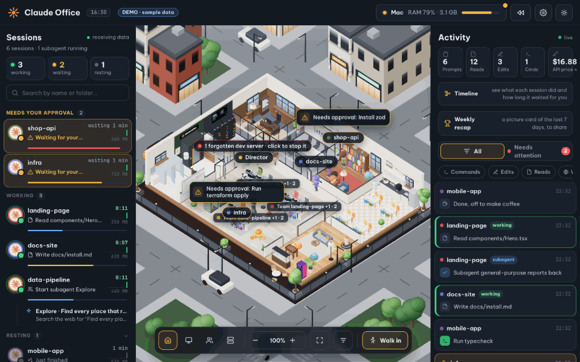

# My Office

English · [Tiếng Việt](README.vi.md)

A 3D office where your Claude Code sessions come to work. Each session is a character at a desk:

- it walks to the library to read files;
- it types at its desk while it edits;
- it goes to the server room to run commands;
- it launches a rocket when you deploy.

The office also looks after your Mac: RAM per session, forgotten dev servers, one-click cleanup.



**Try it before you install anything.** The demo has made-up projects and needs no Claude Code: run `npm run dev` and
open <http://localhost:4310/?demo>. Or try it online, nothing to install: <https://khanh020905.github.io/my-office/>
(a static build of the same demo, published by `.github/workflows/pages.yml`).

**Questions or ideas?** Ask in [Discussions → Q&A](https://github.com/khanh020905/my-office/discussions/categories/q-a), suggest something in
[Ideas](https://github.com/khanh020905/my-office/discussions/categories/ideas), or show your office in [Show and tell](https://github.com/khanh020905/my-office/discussions/categories/show-and-tell).

> My Office is a community project. It is not made by, endorsed by or affiliated with Anthropic.

## Quick start

You need Node.js 20.9 or newer and Claude Code, on macOS, Linux or Windows. The machine panel (RAM, CPU, disk, dev
servers, cleanup) reads each system its own way; opening a session's IDE window and quitting apps are macOS only.

```bash
git clone https://github.com/khanh020905/my-office.git && cd my-office
npm install
node bin/cli.mjs install --service   # adds the hooks to ~/.claude/settings.json and runs the office at login
node bin/cli.mjs doctor              # checks Node, the server, every hook and the background service
```

Then open <http://localhost:4310>.

- `install` backs up `settings.json` before changing it and only adds My Office's own hooks. Running it again adds
  nothing twice.
- To remove everything: `node bin/cli.mjs uninstall`.

| Command | What it does |
| --- | --- |
| `install [--service] [--lan] [--no-approve] [--no-status] [--no-otel] [--no-otel-names]` | Adds three kinds of hooks: event hooks, approval hooks, and a status line that reports your plan's usage. Your own status line keeps running inside it. It also turns on Claude Code's own usage numbers (OpenTelemetry) for "What eats your plan", unless you already send them somewhere: see below. `--service` runs the office in the background from login: launchd on macOS, a systemd user service on Linux, the Startup folder on Windows (no admin needed). `--lan` lets a phone on the same Wi-Fi watch. `--no-approve` leaves out the approval hooks. `--no-status` leaves your status line alone. `--no-otel` leaves telemetry off; `--no-otel-names` keeps the names of your own MCP servers, skills and agents hidden ("custom"). |
| `uninstall` | Removes every My Office hook, the telemetry settings install added, and the background service, and keeps the rest of `settings.json`. |
| `doctor` | Checks each step and says what is missing and how to fix it. |
| `start [--lan]` | Runs the server in this terminal (no launchd). |
| `pin [--new]` | Shows the phone PIN; `--new` changes it and signs every phone out. |

- Restart after changing the code: `launchctl kickstart -k gui/$(id -u)/com.my-office` (macOS) or
  `systemctl --user restart my-office` (Linux). `node bin/cli.mjs doctor` prints the right command for your system.
- Logs: `tail -f data/server.log`.

## What's inside

### The office

- **Three floor plans** (Settings → Office):
  - **Cozy** is one open room.
  - **Company** is a whole 22 × 17 m floor: the director's office, a glass meeting room, a library, a server room, a
    lobby, restrooms, a dining room and a lounge. Desks are grouped in pods by project folder.
  - **Headquarters** adds a wing of four department rooms (44 desks in all). Each room's door plaque shows the project
    working there.
- **You are the director.** Every prompt you send is carried to the right desk. When the work is done, the person
  reports back to your office before taking a break.
- **Subagents** come in through the door and get their brief from their boss. They work where their task belongs,
  report back, and leave.
- **Resting sessions** lean back with a pillow and a blanket after a while. Click a sleeping one and it tells you what
  it finished.
- **People react to you**:
  - switch off a lamp after dark and whoever works next to it complains, walks over and switches it back on (do it
    again and they get crosser; the fourth time they give up);
  - the light switch by the door puts out the whole floor: everyone says so, and the nearest goes to switch it back on;
  - print a page or make a coffee and someone comes for it;
  - pet the cat and it goes to sit on someone's keyboard, who lifts it down;
  - click someone at work and they look up for a second;
  - ring the bell on the meeting table: everyone free comes in, each says what they are working on, and the director
    sends them back;
  - a new trophy brings a cake to the meeting table and a round of applause; a deploy gets applause from the desks
    nearby;
  - plants dry out after a few hours and droop; click a thirsty one and someone waters it.
- **Late at night**, sessions that have been resting for half an hour put their coats on and go home by the lift. They
  come back as soon as there is work, or in the morning. With the city outside they go by the street, each their own way:
  their own scooter from the row parked on the pavement in front of the building, a GrabBike or Xanh SM bike (on the
  back), or a Xanh SM taxi. The session list says where anyone out is ("In Circle K", "Heading home (GrabBike)").
- **The lift after a restart** (company floor): for the first three minutes after the office's server starts (five when
  it starts on a new build) the lift is being serviced: doors half open behind a yellow-and-black barrier ("UNDER
  MAINTENANCE · Sorry for the inconvenience"), the call panel open, the car's light flickering, a technician in blue at
  work with his toolbox and multimeter. Everyone takes the stairs beside it, slower down and out of breath at the top,
  and the group chat grumbles. At the end he takes the barrier away and rides the lift down; after a new build he first
  puts an inspection sticker with the version and the date in the car, which stays there. Nothing waits for it.
  (`?liftservice`, or `?liftservice=new`, shows it.)
- **Out of Claude**: when an account's plan limit (the 5 hours or the week) is used up, the people on that account leave
  their desks for a break: a tea at the pantry tables, a book, a chat. A board on the wall counts down to when it can be
  used again; when it resets the bell rings and they go back to their desks. Anyone whose session is still working keeps
  working. (`?limitout=30` shows it for half an hour.)
- **Games on the lounge TV** (company floor): a 55" TV on a media unit, a console beside it, two controllers. Now
  and then two people who are resting sit down on the sofa and play a match (football 3 v 3, a split-screen racer
  through Saigon at sunset, a rooftop fighter, all pixel art made for the office): they cheer their goals, groan at
  the other's, and get up when work comes in. Click the TV to call two free people over. In first person, press E at
  the TV to sit down and play yourself, against a colleague who comes over or the console; a real gamepad works too.
- **Pool in the lounge** (company floor): a 7-foot table with walnut rails, pearl diamonds and leather pockets, the
  balls really rolling (cushions, kisses, pockets). Now and then two people who are resting take a cue each and play
  a frame: they walk round the table to get behind the white, bend over the cue, take a few practice strokes and play
  through; whoever pots goes again, the white going down hands the table over, first to five wins. Click the table to
  call two free people over. In first person, E at the table picks up a cue: ←/→ (or drag) to aim along the guide
  line, hold Space for power and let go, against a colleague who comes over or on your own.
- **The karaoke box** (company floor, beside the phone booth): a soundproof cabin like the coin-op ones in Vietnamese
  malls, with neon, a screen, two mics and a bench. Now and then someone resting (two, more often on a Friday evening)
  goes in and sings one of the office's own songs: the words run across the screen and fill with colour as they are
  sung, notes rise over the box, its lights pulse, and the machine gives a score at the end, to applause and a post in
  the group chat. The tune follows the Vietnamese words' tones, as folk songs do, and is synthesized in the browser,
  quietly, only with sounds on. Click the box to send someone in; in first person, E at it takes you in to sing.
- **The week's rhythm**: Monday 9:00 the bell rings for the stand-up by itself and everyone free goes round the meeting
  table saying what they're on; Friday 16:00 there's milk tea and bánh tráng trộn in the pantry for whoever is resting.
- **Staff who aren't sessions**: on the company floor a receptionist sits at the lobby reception from 7:45 to 18:15,
  greeting whoever comes out of the lift and seeing them off in the evening. Twice a day a Shopee courier comes up with a parcel for someone resting: he leaves it on the counter, the
  receptionist calls out the name, and they come for it, carry it back to the desk and open it (in the small office he
  calls from the door). At 18:30 the cleaner comes with her trolley, mops the aisles one by one behind a yellow "wet
  floor" sign (the floor shines until it dries, and people walk round it), empties the big bin and goes home.
- **Project areas**: each project (its git repository) has its own desks: on the company floor half a pod (the two
  desks facing each other), with a carpet in the project's colour and its team chip; a project with more sessions takes
  the other half too. The office remembers where each project sat, so its sessions come back to the same desks; only
  when every area is taken do projects share. In the small office, a row each.
- **The Thần Tài – Thổ Địa altar** (company floor): a red-lacquered shrine on the floor by the reception, facing the
  lobby: Ông Địa and Thần Tài inside, the couplet on its pillars, an incense bowl, red altar lamps lit after dark. On the
  lunar 1st and 15th (the real lunar calendar) the receptionist sets out five fruits on a footed dish, xôi gấc and
  yellow chrysanthemums, lights three sticks of incense and bows; the smoke rises for most of an hour (`?lunar=1` to see
  it any day).
- **Lunch from home at the microwaves** (company floor): about a third of the office brings rice from home (more than half
  on a Monday, nobody at the weekend), in a clipped plastic box, a glass one or a stainless tin, carried in an insulated
  bag. From 11:45 they line up at the pantry's two microwaves, phone out: the door opens, the box goes in, the plate
  turns in the light, two or three minutes, "tít tít tít" (with the sound on), the next one steps up. Cá kho or mắm leaves
  smell lines over the corner and a grumble in the group chat; a lid left clipped shut pops. Then lunch at a pantry table
  or at the desk. They don't fetch the GrabFood or go down to the quán cơm (`?comnha` to see it now).
- **Daily duty rota** (trực nhật, company floor): a whiteboard on the pantry wall names today's four chores and who does
  them, the turn moving on each working day among the people of the projects here (HR posts the list in the group chat
  in the morning): wash the cups, which pile up at the sink through the day (the morning coffee, a glass at lunch, the
  afternoon cà phê) and are washed one by one after the nap; take the bin bag out to the bin room on the stairs' landing
  at about five; water the plants in the morning; wipe the pantry's tables. Each does it while resting, never in the
  middle of work. A chore never got to is owed the next morning: the group chat grumbles ("Hôm qua ai trực mà ly chất
  đống vậy 😤"), the one whose turn it was says sorry and does it first thing (the board says so in red; the bin spills
  over meanwhile). The 18:30 cleaner mops the floors and leaves the bin to the rota. No duty at the weekend or on public
  holidays (the official Vietnamese holidays, Tết and Ngày Văn hóa Việt Nam included). Kept in the browser, per day
  (`?duty` to see every chore now).
- **Quarterly fire drill** (diễn tập PCCC, company floor): on the first working day of each quarter HR pins the notice
  in the group chat, and at 15:00 the fire alarm rings (with the sound on) and the horn-strobes on the walls flash. The
  lift goes down to the ground floor and parks; HR, the floor's fire marshal in a red armband, calls everyone out, and
  every person on the floor (working or not, the receptionist, the director) walks down the stairs, never the lift,
  HR last. With the city outside they gather at an assembly point on the pavement by a green "ĐIỂM TẬP KẾT" standee;
  HR takes the roll on her clipboard ("Có!") and reports the count and the time it took; the guard, the other marshal,
  lights a practice fire in a steel tray and shows the powder extinguisher (shake, pull the pin, aim at the base,
  squeeze), the fire goes out, a round of applause, and everyone goes back up in the lift. Purely for show: the
  sessions keep working throughout. As Vietnam's fire law has it (Luật PCCC và CNCH 2024; Nghị định 105/2025/NĐ-CP,
  Điều 16: a facility practises its fire plan at least once a year) and the fire police's guidance (stairs only, never
  the lift). Settings → More turns it off (`?drill` for one now).
- **Make-up Saturdays and swapped days off** (làm bù, nghỉ bù): the office keeps Vietnam's official calendar, its public
  holidays and the Government's swaps (a weekday taken off to join a holiday to the weekend, a Saturday worked for it),
  in a small dated table with each notice (`src/shared/workdays.js`, how to add a year in its comment). On a make-up
  Saturday the office works as on any weekday: the receptionist at the front desk, lunch from home and the quán cơm,
  the duty rota; in the morning someone grumbles in the group chat ("Thứ Bảy mà vẫn phải lên công ty 😩 làm bù mà").
  The day swapped off is a day off (the front desk shut, no lunch, no rota, no Monday stand-up), as are weekends and
  holidays; on the last afternoon before a break of three days or more someone says how long it is, and which Saturday
  to come back on. As announced up to now: Saturday 10/1/2026 for Friday 2/1, Saturday 22/8/2026 for Monday 31/8; none
  for 2027 (the Government chose Tết 4/2–10/2 and Quốc khánh 2/9–5/9 without one).
- **Farewells** (tiệc chia tay): a project that really was at work (on two days or more) and has had no session for 30
  days (Settings → More: 14, 30, 60 or 90, or off) gets a last afternoon in office hours: its person comes in once more
  with the company card on a lanyard and packs the desk into a cardboard box (the little plant, the mug, the photo frame)
  while the area's carpet shows; everyone free gathers at the meeting table for HR's small cake and a big card each one
  signs ("Chúc em thành công", "Nhớ ghé chơi nha"); "Một, hai, ba… cười nào!" and the group photo goes in the group
  chat; the card is handed back to HR; then out by the lift with the box, the carpet rolls itself up and the desk gets a
  "Bàn trống" card. Open the project again and its person comes back to the old company: teased in the chat ("Ủa quay
  lại hả 😆"), the box unpacked, the carpet out again. Only a scene: nothing about the project is touched; the office
  keeps each project's working life in `data/tenure.json` (on its first run it reads, once, only the dates and folders
  of Claude Code's transcripts).
- **Interns made permanent**: a project new to the office (unknown to it and to Claude Code before this came in, so
  nobody becomes an intern on an update) starts as an intern: its people wear an orange "Thực tập sinh" lanyard and a
  small "Thực tập sinh" plate stands on the desk. After 20 finished turns on two different days or more, HR holds the
  ceremony in office hours: the intern goes to her desk, signs the "Hợp đồng lao động" she lays out, the red company
  stamp comes down, the director walks over to shake hands while the people nearby clap, and back at the desk a name
  plate takes the intern's place; the group chat says "Chúc mừng … lên chính thức 🎉" (and someone asks for the milk
  tea it calls for). In the small office, a cake at the meeting table instead.
- **The midday nap**, 12:30–13:30: the blinds come down, the room dims a little, and whoever has nothing running naps
  at their desk, half leaning back under a blanket, half head down on the desk. An alarm at 13:30, and the blinds go up.
- **The look of the place**:
  - two character looks (A · Toy, B · Pixar);
  - three backdrops (city, countryside, beach);
  - a living city: cars shaped like the ones Vietnam drives (VinFast VF3 and VF8, Toyota Vios and Fortuner, Honda City,
    Kia Morning, Ford Ranger, Mitsubishi Xpander, mostly from Kenney's Car Kit), Xanh SM's cyan electric taxis, buses and
    scooters, all stopping at the traffic lights. Grab and
    Xanh SM drivers wear the company's jacket and helmet with its logo on the back, the chest and the helmet; most carry
    a passenger in the company's helmet; GrabFood drivers carry the green box; many riders wear a face mask; people who wait for the green and
    cross on the zebras (umbrellas when it rains), and the shops of the city picked for the weather: GS25, Circle K and
    7-Eleven in Ho Chi Minh City, Circle K, GS25 and WinMart+ in Hanoi, WinMart+ with mì Quảng and seafood in Đà Nẵng;
    and a Mixue in every city: the red front with its lit white letters, the round light box on its bracket, the Snow
    King's statue by the window, the order counter with the soft-serve machine, the menu's light boxes at real prices
    (the 10.000đ cone, the 25.000đ milk tea), staff in black T-shirts, schoolchildren with cones after school and milk tea
    in the evening, and on weekend evenings the Snow King himself dancing out front to its tune ("Oh! Susanna").
    Next to it a Highlands Coffee (the deep red sign with its emblem, phin sữa đá and freeze at real prices, laptops in
    the morning) and a Thế Giới Di Động (the long yellow sign with "thegioididong.com" in black, the promotions on the
    glass, phones on the display tables, staff in yellow, a tube man dancing at the door, 8:00–22:00). Where the chain
    really has shops (Hanoi, Ho Chi Minh City, Đà Nẵng, Nha Trang; painted further down the street in Hải Phòng, Huế and
    Đà Lạt) a Cộng Cà Phê: the army-green front with CỘNG CÀ PHÊ in warm white letters, the white box with its logo out
    on a bracket, a little roof of terracotta tiles, a plank painted "Ở ĐÂY CÓ BÁN CÀ PHÊ"; inside the retro look of
    1980s Hanoi (olive walls, worn wooden floor, low wooden stools, a bench with cushions in the red "chăn con công"
    print, enamel mugs and thermos flasks, an old radio and a wooden-cased TV, faded photographs and a tear-off calendar),
    the menu printed like ration coupons at the real prices (cốt dừa cà phê 59.000đ, bạc xỉu 45.000đ), staff in olive,
    folding metal chairs out front and an old bicycle with a basket of flowers, 7:00–23:00. On weekday afternoons and
    weekend mornings someone resting goes for a cốt dừa ("Đi Cộng làm ly cốt dừa không?"); walking in, you can order at
    the counter or sit on the low stool by the window.
    The streets follow the office clock: in the morning and evening rush twice the scooters, riding three abreast and
    crawling; empty streets in the small hours. Cars pull in to the kerb in front of the shops and along the park,
    indicating, and pull out again later; taxis stop for a fare with their hazard lights on. Street food across the
    street: a bánh mì cart in the morning and late afternoon, a trà đá stall of plastic stools (full in the evening, a
    bulb over it at night); women selling fruit from baskets on a shoulder pole, lottery ticket sellers;
  - the parks across the street go by the hour: old people at their morning exercise in rows at 5:00, badminton and a
    circle kicking a đá cầu at 16:30, children running round, people on the stone benches in the evening (a phone's glow
    after dark). At the trà đá stall two old men play cờ tướng while a few watch, and now and then someone doesn't like
    a move;
  - weekends: a house near the office has a wedding. A pink-and-white tent goes up over its pavement with a flower arch
    (Lễ Vu Quy or Lễ Tân Hôn, 囍). At 8:36 a white car with roses on the bonnet comes for the bride while the family waits
    in áo dài. There's a feast at midday and in the evening, with the couple going round the tables, guests' scooters
    along the kerb and bulbs along the eaves at night (`?wedding` for any day);
  - street trades: two or three xe ôm men wait on their scooters at a corner (6:30–19:30) and sleep on them at the midday
    nap, feet on the handlebar and hats over their faces; someone naps in a hammock between two park trees. From 5:30 to
    8:30 a woman sells xôi from her baskets beside a steaming bánh cuốn pot: people on their way in eat standing, sit
    for a plate, or buy from their scooter at the kerb. By day a barber works under a mirror nailed to a tree, next to a
    vá xe corner with tyres, a compressor and a scooter up on its stand;
  - concrete poles with sagging bundles of power cables along the streets, coils of spare cable and a transformer box.
    Now and then an ambulance (115) or a fire engine (114) comes through with lights flashing and siren sounding;
    traffic pulls over to let it by (`?siren` to see one);
  - the traffic police (CSGT), as they work today: now and then two officers in the yellow uniform ride by on white
    patrol bikes (C.S.G.T / TRAFFIC POLICE, lights flashing). Some mornings and late afternoons they set up a
    checkpoint on the office's pavement just after a crossing: the bikes up on the pavement, a sign, cones along the
    kerb, one officer at the lane's edge with the baton, the other by the bikes (reflective vests after dark). They stop a
    rider without a helmet, three on a scooter, one on the phone or one through the red light: a whistle, the scooter
    pulls in, the officer salutes, says why, checks the licence and registration on VNeID, writes the record and the
    rider signs. Some evenings (more on Fridays and Saturdays) it is an alcohol check: anyone may be asked to blow, and a
    high reading means the scooter is held and the rider walks. The chip over the checkpoint opens a card with the
    steps (Circular 73/2024/TT-BCA), the fine range and clause (Decree 168/2024/NĐ-CP, article 7) and the record itself,
    a pretend one with made-up names and plates. In first person, E by them does the same (`?csgt` to see one);
  - a quán nhậu (a street-side beer place) on the park's edge across the street, 16:30–23:00: low blue plastic tables,
    red and blue stools, an ice chest and crates of beer (a made-up "BIA", no real brand), peanuts, grilled dried
    squid, snails and a hotpot steaming on its burner, a charcoal grill smoking with the owner fanning it, a waiter going
    to and fro, a hand-painted sign and a string of bulbs after dark; the regulars raise their glasses now and then
    ("Một, hai, ba, dô!"), more of them on Fridays and Saturdays. On Fridays at about 18:30 (and one evening in four on
    other weekdays) a few people from the office who are resting go down for a few rounds: an invitation in the group
    chat, the long table by the kerb, a clink each round and cheeks a little redder each time; work coming in calls one
    back up. Nobody rides home after a drink: "Đã uống rượu bia thì không lái xe" in the chat, a GrabBike, a Xanh SM bike
    or taxi to the kerb, and the scooter stays in the row till the morning. On the alcohol checkpoint's evenings the
    police stand on the quán's street, and a regular who rides off on his own scooter is stopped and breath-tested. The
    quán's chip opens its menu (illustrative prices) and who from the office is at the table; in first person, E to sit
    down with them (`?nhau` to see it any time);
  - a pickleball court by a park, at its real size (20 × 44 ft, the kitchen 7 ft each side of the net, the net 34 in in
    the middle and 36 in at the posts), blue on green, chain-link fence and windscreens, LED floodlights in the evening,
    "200.000–300.000đ/giờ sau 17h" on the board at the gate; the neighbourhood plays doubles on weekday evenings and
    weekend mornings and evenings, in visors, tennis skirts and court shoes. On a day the CI has stayed green someone asks
    "Tối nay kèo pick không?" in the group chat at five, and at half past four people resting go down to play (a fifth
    films it); a test run while they play is a point, each passing test a shot over the net and the first failing one
    into the net. After an hour the clip goes into the chat with everyone's share of the court (70k). In first person,
    E at the gate (`?pickle` to see the court in use);
  - a Korean-style self photo studio across the street: a pink container, "Chụp ảnh Hàn Quốc" in pink neon, two booths
    behind their curtains (feet showing under them), a basket of props (cat-ear headbands, giant heart sunglasses, party
    hats), the price board (a 4-frame strip 70k, the big print 100k), young people coming in the evening and queueing at
    the weekend. A release (a new version tag in a session's repository, or a GitHub release) sends four people resting
    there: four frames, four silly poses with the props, the flash; the strip goes into the group chat and they come back
    up still wearing the props and pin it on the whiteboard, the version under it: the six newest stay, a release history.
    At the weekend they are back nearly two hours later. In first person, E at the door for a strip of your own;
  - half the scooters in the row outside the office are electric (the smooth shape of Vietnam's 2026 e-scooters, an LED
    headlight across the apron, a hub motor, no exhaust), each with a five-bar battery gauge that follows this
    computer's battery (`pmset` on macOS, `/sys` on Linux; hidden where there is none, as on Windows), filling bar by
    bar while it charges. Under 20%, the owner of the emptiest one rides it to the battery-swap cabinet on a park's
    corner (V-Green's kind: lockers with their status lights, the screen and the QR code), takes out the empty pack,
    scans, puts it in, takes a charged 1.5 kWh one (two or three minutes, 9.000đ) and rides back with it full. In Hà
    Nội, the sign of the low emission zone inside Ring Road 1 (from 1 July 2026) stands at a corner near the office;
  - traffic lights have Vietnam's countdown boxes beside them, red or green digits counting down the light. On a hot
    sunny day (33 °C+, from the real weather) scooters wait at a red light back in a street tree's shade instead of at
    the stop line;
  - riders as you see them on Vietnamese streets: on sunny days many women in floral "ninja" sun suits with sunglasses
    and a wrap skirt; now and then a scooter carries a fridge, a ladder, a gas cylinder, a potted tree, a chicken cage or
    a stack of styrofoam boxes taller than the rider. On the lunar 1st and 15th, in front of small family shops, someone
    burns votive paper in a steel drum by an offering table (`?lunar=1` to see it any day);
  - going out (city backdrop): before lunch on the company floor a GrabFood rider stops at the kerb and someone resting goes
    down in the lift for the team's lunch; now and then someone resting pops down to the convenience store across the
    street, waits for the green man, and comes back with a drink; on a really hot afternoon (the city's real weather,
    32° and up) the trip is for a 10k cone at the Mixue, and when CI goes green again someone goes for ice cream for
    everyone. The day's first one in stops at the Highlands for a cà phê on the way up, and when Claude Code on this
    computer updates (its editor extension, looked at every few minutes) someone runs to Thế Giới Di Động to "lên đời"
    and the group chat hears the new version. Work coming in calls them back at a run;
  - day and night by the clock;
  - real weather, if you pick a city;
  - seasonal decorations (Halloween, Christmas, Lunar New Year).
- **Walk in**: explore the office in first person (WASD to move, E to use what is in front of you). Walk up to someone
  asleep and press E to wake them: they stretch, say something, and doze off again (and get crosser if you keep at it).
  With the city outside, press E at the lift (or the door) to go down to the street: walk the pavements, cross (the
  traffic stops for you), get a drink at the convenience store, a cone or a milk tea at the Mixue, a bánh mì at the cart,
  and E at the door to go back up.
- **A short tour on the first visit** points at what you can click (the lamp, the switch, the coffee machine, the
  printer, the cat, the bell, a person, walking in). Settings → More → "Show the tour again".
- **A 15-second clip** (in photo mode): a video of the office from morning to evening, square for a feed or vertical
  (9:16) for Reels, TikTok and Shorts, the camera turning slowly, with a title and the day's numbers, and an original
  lo-fi tune made in the browser (no samples, nothing to clear; it can be turned off). MP4 in Chrome, ready for a post.
- **Photo mode** (P): hide every panel, turn the camera any way you like, and save a PNG up to 4K with the names
  painted in.

### Your work, live

- **Desk screens** show what each session is doing: the editor, a terminal, a browser, a chat, a permission dialog.
- **Git**:
  - a desk gets messier as uncommitted files pile up;
  - a commit prints a page on the printer;
  - a push launches the rocket;
  - a failing CI run shows a red notice (with a siren, if sounds are on).
- **The whiteboard** lists each session's task and progress, plus your own sticky notes.
- **The team chat** (top bar), drawn like a group chat on a Vietnamese messenger: people post about what really
  happens (a task done, a commit, a push, CI going red, the plan running out, a parcel at reception, the lunch poll,
  the Friday tea with a photo of the table, birthdays), type for a moment first, react and answer each other, and answer
  you: @ someone and they say what they're on, "meeting" rings the bell, "milk tea" brings the Friday tea out. Each
  person's picture is their own chibi; stickers, polls, reactions, a pinned message, the unread count. Kept on this
  computer (`data/chat.json`) and seen by your phones too. Written to "The whole group" it is just chatting; pick a
  conversation in **To** over the input and Claude itself answers (below).
- **Timeline and replay**: one lane per session; replay the last hour or day at up to ×120; export it as a video.
- **Weekly recap**: a picture card of your week with Claude, ready to save or paste into a post. It shows the hours,
  prompts, edits and commands, the cost at API prices, and your busiest project.
- **A trophy cabinet** for milestones: 1,000 prompts, 10,000 edits, the first deploy, and more.

### Approve from the office

- **Permission requests** show up as cards: Allow, Always allow, Deny. Keys Y, N and A answer the top card.
- **Risky commands** are marked red, need two clicks and never offer "Always allow". That covers recursive deletes,
  force pushes, `curl | sh`, `sudo`, and anything mentioning prod.
- **Claude's questions and plans** are cards too, with every option, a free-text answer, and "approve" or "keep
  editing".
- **When this applies**: only while the page is open and visible, and for at most 45 seconds. Otherwise Claude Code
  asks as usual. You can turn this off in Settings.
- **Stuck loops get broken**: when a session runs the same thing and gets the same error three times in a row, its
  fourth try is blocked and Claude is told to change course (a synchronous `PreToolUse` hook that answers from memory;
  it gives up after 0.3 s, so with the office closed or busy the call simply goes ahead). The person's name tag turns
  red with "stuck", the team chat gets a card ("api-worker ran `npm test` and got the same error 3 times: try 4
  blocked") with **Stop** (at its next step; a run started from the office is stopped outright) and **Send a hint**
  (Claude reads it with its next step; once its turn is over, the hint carries the conversation on), and your phone
  gets a notification. It also points out compaction after compaction and spending for 10 minutes with no file edited,
  without blocking anything. Anything you type to the session forgives it. Settings → More: on or off, after how many
  failures, after how many minutes. Older installs: run `node bin/cli.mjs install` once more to add the hook.
- **"Fix it" when CI goes red**: when the latest CI run of a repository a session works in fails (read with `gh`), the
  team chat gets a card from that session with a link to the run and **Fix it**. It hands Claude the run: read the
  failing step's log, fix it, run that check locally, report back, and don't push. A session at work gets it as a note
  at its next step; a resting one carries its conversation on. The card says when the CI is green again. From a phone
  only when work from phones is allowed.

### Your plan and your Mac

- **The plan pill** shows your closest usage limit (5 hours, weekly, per model) and warns at 80% and 95%. With a second
  Claude Code login on the same machine (its own `CLAUDE_CONFIG_DIR`, such as `~/.claude-org2`), that account's limits
  show too, and its sessions wear a small badge with the account's name.
- **Several Claude accounts**: "Add a Claude account" in the plan card makes the account's folder and signs it in from
  the browser, no terminal needed. Hover an account to rename it, click "Use" to start new sessions on it, or drag it by
  its grip to set the order. With "Switch accounts when one runs out" on, new sessions move down that order when one
  runs out, and come back to the top one once it resets. It works through the editor's Claude Code extension (`claudeCode.claudeProcessWrapper`, set
  and removed by the office) or a shell alias the card shows; the accounts share history, settings and memory by links
  to `~/.claude`. macOS and Linux.
- **Moving an open session to another account**: click its person, then "Change account" and pick one. A session in
  the editor stops for a moment while it rests, and carries on with the new account, the same conversation, as soon as
  you write in it again (the office starts it there through the same script; its person waits at the desk meanwhile).
  A session in a terminal gets the command that resumes it there. With switching on, the sessions open on an account
  that runs out for a while (not a short rate limit) move by themselves too; a box under the switch turns that off.
- **The Mac pill** opens RAM, swap, CPU and disk. It says why the Mac is slow (memory spilled to disk, who holds the
  most) with one button to close every idle Claude session, and suggests the rest: stop a forgotten dev server, quit a
  heavy app, clear caches. Idle sessions can also be closed on a timer (off by default). Every action is checked first
  and logged.
- **Forgotten work** (in the Mac panel): every git worktree and main checkout of the repositories your sessions worked
  in (Claude Code's `.claude/worktrees` too) that still holds files not committed, commits not pushed or a stash, with
  its branch, size and when it last changed. **Open** it in your editor or terminal, **Give it to Claude** (a new
  conversation in that folder, the words ready to change), or **Delete** a worktree with nothing left in it, after a
  confirmation: never the main checkout, never one with work in it or a session open, and git (no `--force`) checks
  again right before.
- **Each session** has a context bar and a waste bin that fills up with context. It also shows its cost at API prices:
  with a subscription, this is not your bill.
- **The cache clock**: a cup of coffee on each resting desk whose steam fades as the session's prompt cache cools, gone
  once it is cold. While it is warm, writing to the session again is cheap; once cold, the next message reads the whole
  conversation again. The session's drawer says "Prompt cache still warm for ~23 minutes" or "gone cold: the next
  message re-reads ~180k tokens", and so does the chat's **To** ("warm ~23 min · cheap to continue"), so you can answer
  before it cools. It comes from the status line's `prompt_cache` (Claude Code 2.1.251 or later) and a resumed
  session's `SessionStart`; without them it is a guess from the end of the last turn and the documented lifetime (an
  hour on a subscription, five minutes on an API key), marked "(estimated)". Settings → More can tell your phone when
  a session waiting for your answer is five minutes from going cold (off by default).
- **What eats your plan** (the line at the bottom of the plan card, or ••• in the group chat, also on a phone): where
  Claude Code's usage goes, today or over 7 days. Who eats the most (MCP servers, skills, plugins, subagent types: "MCP
  github 34% · Skill pdf 12% · Subagent Explore 9%"), split by model and by source (main conversation, subagents,
  background work), a column a day, then by project and by session. Each figure is in USD at API prices and, once the
  plan's week is known, in ≈ % of the weekly limit. The numbers are Claude Code's own OpenTelemetry counters and
  events (code.claude.com/docs/en/monitoring-usage), sent by Claude Code to the office on this computer
  (`/v1/metrics`, `/v1/logs`, OTLP/HTTP JSON) and kept as daily sums in `data/otel/` for 30 days. `install` adds them
  to the `env` of `~/.claude/settings.json`, tagged `MY_OFFICE_OTEL` so `uninstall` takes out exactly those keys, and
  never if you already send telemetry somewhere (settings, your shell or a managed policy): it prints how to add the
  office as a second exporter to your OpenTelemetry Collector instead. Prompts stay hidden (`OTEL_LOG_USER_PROMPTS` is
  not set); `OTEL_LOG_TOOL_DETAILS=1` gives the real names of your own MCP servers and skills, and the tool input it
  adds to the events is dropped unread. A new Claude Code session picks the settings up; open ones keep their old ones.

### Small things

- English or Vietnamese (Settings → Display).
- Graphics: Auto, Low, Medium or High. Auto steps down by itself when frames come late, and remembers it per device.
- Streamer mode blurs commands, paths and chat for recording.
- List mode turns the 3D off and shows sessions as cards. It saves battery and works without WebGL.
- Open on your phone: same Wi-Fi, or anywhere through the Cloudflare tunnel (below), 6-digit PIN. Watching, plus
  approving if you turn on "Approve from a phone" on the Mac. Claude Code's own Remote Control (`/rc`) works too: the
  session's QR code in its drawer opens that conversation in the Claude app.
- **To**, over the chat's input: pick a conversation and write (or speak): that very conversation carries on. Resting in
  your editor, it is closed there first (safely, the way an account move does) and its tab takes it up again, with what
  you said on the phone, the next time you write there; one at work on the Mac waits. A live card under your message
  shows what Claude does (📖 reads, ✏️ edits, ▶ commands, an approval it waits for), then its answer comes, marked
  Claude, quoting you. Long messages fold with "Read more". Replying to one of Claude's answers writes to it too. Or pick **＋ a new conversation in a project** (the
  folders sessions have worked in, the latest first): Claude starts fresh there, and what you write next carries it on.
- **Prompt helper**, over the chat's input when you write to Claude: worked out in the page (nothing is sent), it points
  out what usually costs a round trip, one tip at a time once you stop typing: a screenshot with a word or two, "make it
  better" with no criterion, "this one" or "item 4" pointing at nothing, several jobs in one message, a message too
  short to act on. Its chips fix the draft (a sentence for the photo, "Criteria: ", the jobs numbered in the order
  they should be done); a tip you close stays closed for that message, and it never stops one going. "✨ Rewrite it
  clearly" asks Claude Code itself to rewrite it as Goal / Context / Done when (a small model, no tools, one turn, the
  text only, 20 an hour; it uses a little of your plan), with Undo. Off in Settings → More → Group chat.
- **Notifications on your phone** (Web Push, from `server/push.mjs` with nothing but `node:crypto`; shown by
  `public/sw.js`): Claude's answers, and an approval a phone's work needs while no office page is open, even with the
  phone locked. Turned on on each phone (⚙ → More → 📱) over the https address; on an iPhone, add My Office to the home
  screen first (Share → Add to Home Screen: it becomes an app, full screen, with its icon). The Mac's phone window counts
  the phones and sends a test. Subscriptions are posted only to the browsers' own push services.
- **Give work** (📋 in the team chat, or @ a conversation and tap "Give work"): pick a conversation, carried on with
  its whole context as a new branch of it (the one open in your editor is left as it is), or a folder a session has
  worked in, for a new one. Type or speak (🎤, the browser's speech recognition: over https or on the Mac itself), and
  add up to 4 photos. The Mac runs it as `claude -p`; its commands ask for approval like any session's, and its answer
  comes back to the chat. From a phone only once "Give Claude work from a phone" is on, on the Mac; at most 3 at a
  time and 12 an hour.
- **Quick commands**: writing "To" a conversation, a row of chips over the input fills in a prompt you use often (run
  the tests, commit and push, deploy…). ✎ edits them (up to 12, kept on the Mac, the same on your phone), and
  **⭐ Save this** keeps what you are writing as one more in one tap, named after its first words.
- **Phone work as background sessions** (the phone window, under "Give Claude work from a phone"; off by default): each
  piece of work is a Claude Code background session (`claude --bg`, agent view, Claude Code 2.1.257 or newer) instead of
  `claude -p`. Its card still shows its steps, Stop and its answer, from the session's own hooks; an approval or a
  question waits on the phone and in the office until you answer it (no 45 s), and the card says how to carry it on at
  the Mac (`claude attach <id>`). It edits your working copy as before (no worktree of its own, nothing pushed by
  itself). A Claude Code without them, or a folder Claude Code doesn't trust yet (type `claude` there once in a
  terminal), runs it the old way and the chat says why.
- **Cut in while it works** ("Chen lời"): 💬 on a working card, or writing with "To" to a conversation that is busy (it
  asks first), puts your note ("fix the tests too", "wrong file, stop") into that session now, through its inbox socket
  (Claude Code's cross-session messaging, 2.1.224 or newer): Claude reads it right after the step it is on. Claude Code
  hands it over as a message from another session, so it never counts as your approval. A session that can't take one
  (an older Claude Code, one skipping every approval, settings that hold or refuse such messages) is said so in the chat,
  and the note goes as an ordinary message once it is done.
- On a phone the office lays itself out like an app, upright or held sideways: a compact top bar (plan, Mac, settings),
  the office filling the screen, and a tab bar (Office · Sessions · Activity · Approve · Chat, with counts) whose tabs
  open each panel as a full-screen sheet. A waiting approval floats just above the tabs with thumb-sized buttons.

## Privacy and safety

- **Everything stays on your Mac.** Hooks post to `127.0.0.1` in the background. If the office is not running, Claude
  Code carries on as normal. The stuck-loop hook is the one that waits for an answer, 0.3 s at most, and prints
  nothing when the office is closed or slow, so it never holds Claude Code up because of the office.
- **Secrets are masked.** Strings that look like passwords, tokens or API keys are masked before they are stored or
  shown.
- **Plan usage** is read the way the IDE's Usage panel reads it:
  - the office takes Claude Code's login from the Keychain each time, and never stores or logs it;
  - it asks Anthropic for the numbers every 2 minutes while a page is open;
  - the address it calls is undocumented and may change.
- **Network calls you can switch off**:

  | Call | When it happens | Off switch |
  | --- | --- | --- |
  | Plan usage | while a page is open | `OFFICE_USAGE=0` |
  | GitHub CI check, through your `gh` login | while a page is open | `OFFICE_CI=0` |
  | Translation into Vietnamese | only in Vietnamese mode | `OFFICE_TRANSLATE=0` |
  | Weather | only after you pick a city | leave the city empty |
  | Rewriting a message for Claude, through Claude Code (your plan) | only when you tap “✨ Rewrite it clearly” in the chat | Settings → More → Group chat |

- **Usage numbers** ("What eats your plan") go from Claude Code to `127.0.0.1` only: the receiver refuses anything
  from a web page, the Wi-Fi or the tunnel, reads JSON only (4 MB a request at most), and keeps daily sums of cost and
  tokens; e-mail addresses, prompts and commands are never stored.
- **Stop buttons** re-check the process ID **and its start time** just before acting. A new process that reused an
  old ID is never stopped by mistake. Every stop, cleanup and approval is written to `data/actions.log`.
- **Phones**:
  - The server listens on `127.0.0.1` only, until you turn on "Open on phones" in the phone window (or install with
    `--lan`). Then it also listens on the Mac's own network addresses (Wi-Fi, Ethernet, Tailscale), never on all of
    them, and turning it off closes them and cuts the phones off. "New PIN" there signs every phone out.
  - Phones need the PIN (a random 6 digits, or your own of 6 to 10 set in the phone window; not an easy one like
    000000 or 123456); five wrong tries lock that address for 15 minutes. "Remember this device" (ticked at first) keeps
    the phone signed in for a year, renewed as it's used; untick it on a borrowed phone and it lasts until the browser
    closes. A new PIN signs every phone out; a phone can change it too (⚙ → More → 📱), with the one it has now.
  - Phones watch. They approve only once you turn on "Approve from a phone" on the Mac (off by default; only the Mac
    can switch it): allow once or deny, answer a question or a plan; never "always", and a risky (red) command can
    only be denied from a phone. Each answer from a phone is logged with its address. Hooks come from the Mac alone.
  - Away from home (mobile data, another Wi-Fi): "Use it when you're out" in the phone window starts a Cloudflare quick
    tunnel (cloudflared, downloaded once; no account, no domain) and shows its https address and QR code. The address
    stays while it's on, across restarts of the office. Quick tunnels hold a stream's data back until it ends, so a page
    opened through one asks instead (`/api/live`, answered as soon as there is something new). What comes through it is from the internet whatever its
    address: the PIN only (no token links), an https-only cookie, and nothing but the PIN, chat messages, presence,
    approvals and work (these two only if allowed on the Mac) may be sent; hooks, stopping processes, accounts and the
    switches are refused. Off: cloudflared stops and the phones are cut off. A Tailscale network works too (the window
    shows its address).
  - While the tunnel is on and the Mac is on its charger, the office runs macOS's `caffeinate` so the Mac doesn't
    sleep (the display still turns off). On battery, or with the tunnel off, it sleeps as usual.
  - The page is plain HTTP, so only use `--lan` on a network you trust.

## Settings from the environment

| Variable | Default | What it does |
| --- | --- | --- |
| `OFFICE_PORT` | `4310` | The port. |
| `OFFICE_HOST` | `127.0.0.1` | The address to listen on (`install --lan` sets it for you). |
| `OFFICE_LANG` | `en` | The language until someone picks one in Settings. |
| `OFFICE_DATA_DIR` | `data/` | Where the office keeps its files. |
| `OFFICE_USAGE` | on | `0` stops reading your plan's usage. |
| `OFFICE_CI` | on | `0` stops checking CI runs with `gh`. |
| `OFFICE_TRANSLATE` | on | `0` leaves Claude's English descriptions untranslated in Vietnamese mode. |

## Development

```bash
npm install
npm run dev                   # Turbopack with hot reload: http://localhost:4310/?demo
npm run lint && npm run typecheck && npm test
npm run build && npm run test:e2e   # all of them (CI runs the @smoke ones: no GPU there)
node scripts/build-demo.mjs   # the static online demo, into demo-site/
node scripts/record-gif.mjs   # this README's GIF, recorded from a running office
npm run smoke                 # starts the built server and checks it works on this system
```

| Part | Where | Built with |
| --- | --- | --- |
| The server | `server/` | plain Node.js |
| The page | `app/` and `src/components/` | Next.js (App Router) |
| The 3D office | `src/office/` | three.js, one module per thing |
| Every word on screen | `src/i18n/locales/` | one folder per language |

[docs/ARCHITECTURE.md](docs/ARCHITECTURE.md) has the map. Read [CONTRIBUTING.md](CONTRIBUTING.md) before sending a pull
request.

## Credits

| What | From | Licence |
| --- | --- | --- |
| Ideas | agents-at-work | |
| Ideas, and the dangerous-command patterns | cubicle-crew | MIT |
| Ideas, and the RAM-growth and CPU rules | cc-reaper | Apache-2.0 |
| Libraries | [three.js](https://threejs.org), qrcode.js | MIT |
| Fonts | Be Vietnam Pro, JetBrains Mono | SIL Open Font License |
| Brand icons | [Simple Icons](https://simpleicons.org) | CC0 |
| Car models | [Kenney Car Kit](https://kenney.nl/assets/car-kit), see `public/assets/vehicles/README.md` | CC0 |
| Shop signs and liveries (Circle K, GS25, 7-Eleven, WinMart, Xanh SM, Grab, Shopee) | Wikimedia Commons, see `public/assets/brands/README.md`; the Shopee mark from Simple Icons | public domain as text logos; trademarks of their owners, not affiliated |
| The Mixue shop | drawn and modelled in code (`shop-mixue.js`): no artwork of the chain's; its tune is "Oh! Susanna" (Stephen Foster, 1848) | public domain melody; the name is its owner's trademark, not affiliated |
| The Highlands Coffee shop | drawn and modelled in code (`shop-highlands.js`): no artwork of the chain's | the name is its owner's trademark, not affiliated |
| The Thế Giới Di Động shop | drawn and modelled in code (`shop-tgdd.js`): no artwork of the chain's | the name is its owner's trademark, not affiliated |
| The Katinat shop | drawn and modelled in code (`shop-katinat.js`): no artwork of the chain's | the name is its owner's trademark, not affiliated |
| The Phúc Long shop | drawn and modelled in code (`shop-phuclong.js`): no artwork of the chain's | the name is its owner's trademark, not affiliated |
| The Cộng Cà Phê shop | drawn and modelled in code (`shop-cong.js`): no artwork of the chain's, only its generic retro look | the name and its logo are its owner's trademarks, not affiliated |
| The Long Châu pharmacy | drawn and modelled in code (`shop-longchau.js`): no artwork of the chain's | the names (Long Châu, FPT Retail) are their owner's trademarks, not affiliated |
| The Điện Máy Xanh shop | drawn and modelled in code (`shop-dmx.js`): no artwork of the chain's | the name is its owner's trademark, not affiliated |
| The Vietcombank ATM booth | drawn and modelled in code (`street-atm.js`): no artwork of the bank's | the name is its owner's trademark, not affiliated |
| The V-Green battery-swap cabinet | drawn and modelled in code (`street-ev.js`): no artwork of the company's | the name is its owner's trademark, not affiliated |
| Weather | [Open-Meteo](https://open-meteo.com) | |

## Licence

[MIT](LICENSE). The brand names and logos above stay their owners' trademarks; My Office is not affiliated with any of them.
