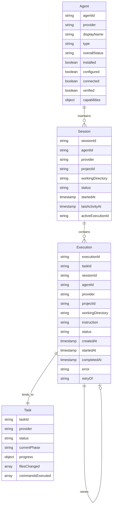

# My Office Agent Control Center — Architecture, Implementation & Verification Report

> **Status:** IMPLEMENTED, TESTED & VERIFIED  
> **Date:** November 12, 2026  
> **Module:** Agent Control Center (Phase 1 — Agent Management, Session Control & Execution Lifecycle)  
> **Environment:** Windows 11 (`win32 10.0.26200`), Node.js v20.x, Next.js 16 + Vanilla Web Components

---

## Executive Summary

The My Office **Agent Control Center** has been designed, implemented, and verified to evolve My Office from an agent observability dashboard into an active multi-agent operations and control platform.

While the Activity Center serves as the authoritative timeline and execution evidence layer, the Agent Control Center acts as the centralized command surface where users can:
1. Inspect truthful agent availability, installed binaries, and configuration states.
2. Monitor active and resting execution sessions across independent project directories.
3. Assign new tasks to verified providers with strict path boundary and permission validation.
4. Execute supported runtime controls: mid-turn follow-up instructions, process cancellation, and retry attempt linking.
5. Identify unsupported operations fail-closed without decorative or fake controls (e.g. no fake pause button, no automated launch for GUI apps).
6. Jump directly from any session or execution into its real-time Activity Center task timeline.

---

## Section A: Architecture Audit & Reusable Infrastructure

### 1. Existing Foundation Reused
- **Activity Center & Task Aggregator** (`src/shared/task-aggregator.js`, `src/office/ui/activity.js`): Reused as the single authoritative state for execution progress, file tracking, and command evidence.
- **Provider Adapters & Host Binary Probing** (`server/tools/adapters/base-adapter.mjs`, `claude-adapter.mjs`, `codex-cli-adapter.mjs`, `codex-app-adapter.mjs`, `antigravity-adapter.mjs`): Reused for truthful agent detection and binary resolution on Windows host.
- **Agent Integration State** (`server/tools/agent-integration-state.mjs`): Reused for evidence TTL and observer tracking.
- **Provider Runners** (`server/tasks.mjs` for Claude Code, `server/codex-runs.mjs` for Codex CLI): Reused for process spawning, worktree sandboxing, and graceful SIGINT/SIGTERM termination.
- **Security Policy Engine & Authorized Project Roots** (`server/tools/security-policy-engine.mjs`, `server/index.mjs` `knownDirs`): Reused to enforce that tasks are only dispatched into verified project directories.

### 2. Gaps Identified & Addressed
- **Unified Capability Model**: Previously, capabilities were loosely checked per adapter. Created [server/control/capability-registry.mjs](file:///d:/somehting%20code/my-office/server/control/capability-registry.mjs) to evaluate operations explicitly (`start`, `steer`, `cancel`, `pause`, `resume`, `retry`, `observe`, `inspect_session`, `retrieve_result`).
- **Execution Lifecycle Store**: Dispatched tasks now generate durable Execution records with retry parent linking in [server/control/control-manager.mjs](file:///d:/somehting%20code/my-office/server/control/control-manager.mjs).
- **Dedicated Control Center UI**: Built [src/components/office/ControlDrawer.tsx](file:///d:/somehting%20code/my-office/src/components/office/ControlDrawer.tsx) and [src/office/ui/control-view.js](file:///d:/somehting%20code/my-office/src/office/ui/control-view.js) with 4 semantic tabs (`Agents Overview`, `Sessions`, `Task Dispatch`, `Executions History`).

---

## Section B: Provider Capability Matrix

Capabilities are evaluated explicitly and truthfully across all 4 providers:

| Provider | Type | Installed | Configured | Connected | Verified | Supported Controls | Unsupported Controls & Reasons |
| :--- | :--- | :---: | :---: | :---: | :---: | :--- | :--- |
| **Claude Code** | `cli_agent` | **Yes** (`claude.cmd`) | **Yes** | **Yes** | **Yes** | `start`, `steer`, `cancel`, `retry`, `observe`, `inspect_session` | • `pause` / `resume`: Claude Code CLI does not expose an external pause API or safe suspend mechanism. |
| **Codex CLI** | `cli_agent` | **Yes** (`codex.cmd`) | **Yes** | **Yes** | **Yes** | `start`, `cancel`, `retry`, `observe`, `inspect_session`, `retrieve_result` | • `steer`: Executes batch prompt turns; no interactive mid-turn stdin steering.<br>• `pause` / `resume`: Process suspension not supported. |
| **Codex App** | `desktop_app` | **No** (GUI app absent) | **Yes** (`plugins/`, `skills/`) | **Yes** (hook observer) | **No** | `observe`, `inspect_session`, `retrieve_result` | • `start`: Desktop GUI application; tasks must be initiated by user in GUI.<br>• `steer` / `cancel` / `pause` / `resume` / `retry`: External lifecycle control unavailable. |
| **Antigravity** | `multimodal_agent`| **Yes** (`agentapi.bat`) | **Yes** | **Yes** (file observer) | **No** | `observe`, `inspect_session`, `retrieve_result` | • `start` / `steer` / `cancel` / `pause` / `resume` / `retry`: Integrated purely as an activity observer. |

---

## Section C: Data Model

The Agent Control Center establishes a clear separation of concerns across four entities:



---

## Section D: Files Created & Modified

### New Backend Modules
- [server/control/capability-registry.mjs](file:///d:/somehting%20code/my-office/server/control/capability-registry.mjs): Truthful provider capability evaluation and fail-closed permission checks.
- [server/control/control-manager.mjs](file:///d:/somehting%20code/my-office/server/control/control-manager.mjs): Durable agent execution manager, session isolation, dispatching, steering, cancellation, and retry linking.
- [server/control/control-api.mjs](file:///d:/somehting%20code/my-office/server/control/control-api.mjs): REST endpoints for `/api/control/agents`, `/api/control/sessions`, `/api/control/dispatch`, `/api/control/executions`.

### New Frontend Modules & Markup
- [src/components/office/ControlDrawer.tsx](file:///d:/somehting%20code/my-office/src/components/office/ControlDrawer.tsx): Dedicated Agent Control Center drawer component with 4 semantic tabs.
- [src/office/ui/control-view.js](file:///d:/somehting%20code/my-office/src/office/ui/control-view.js): Client-side controller handling agent rendering, session management, interactive dispatch, follow-up steering, and timeline navigation.

### Updated Integration Files
- [server/index.mjs](file:///d:/somehting%20code/my-office/server/index.mjs): Initialized capability registry, control manager, and bound `/api/control/*` routes.
- [app/page.tsx](file:///d:/somehting%20code/my-office/app/page.tsx): Included `<ControlDrawer />` in the main office page layout.
- [src/components/office/TopBar.tsx](file:///d:/somehting%20code/my-office/src/components/office/TopBar.tsx): Added `Control` navigation action button (`#btn-control`).
- [src/office/main.js](file:///d:/somehting%20code/my-office/src/office/main.js): Registered `uiControlView` in the office boot sequence.

### Tests
- [tests/unit/control-capability-registry.test.mjs](file:///d:/somehting%20code/my-office/tests/unit/control-capability-registry.test.mjs): Unit tests for capability accuracy across all 4 providers.
- [tests/unit/control-manager.test.mjs](file:///d:/somehting%20code/my-office/tests/unit/control-manager.test.mjs): Unit tests for dispatch, steering, cancellation, retry linking, and persistence.
- [tests/e2e/control-center-live.spec.ts](file:///d:/somehting%20code/my-office/tests/e2e/control-center-live.spec.ts): Playwright end-to-end browser test capturing screenshots.

---

## Section E: Verified UI Screenshots

Screenshots were captured using Playwright against the live running server in [docs/screenshots/control/](file:///d:/somehting%20code/my-office/docs/screenshots/control/):
1. **Agent Overview**: [docs/screenshots/control/control-agent-overview.png](file:///d:/somehting%20code/my-office/docs/screenshots/control/control-agent-overview.png) — Overview of all 4 providers with binary paths, verified badges, and supported controls.
2. **Session Management**: [docs/screenshots/control/control-session-management.png](file:///d:/somehting%20code/my-office/docs/screenshots/control/control-session-management.png) — Active sessions list with working status badges, follow-up steering button, and timeline navigation.
3. **Task Dispatch Panel**: [docs/screenshots/control/control-task-dispatch.png](file:///d:/somehting%20code/my-office/docs/screenshots/control/control-task-dispatch.png) — Task assignment interface with target provider selection, working directory validation, and instruction prompt.
4. **Execution Detail & History**: [docs/screenshots/control/control-execution-detail.png](file:///d:/somehting%20code/my-office/docs/screenshots/control/control-execution-detail.png) — Executions list showing running and succeeded tasks, cancel/retry actions, and Activity Center link.

---

## Section F: Real Execution Evidence

From [tests/unit/control-manager.test.mjs](file:///d:/somehting%20code/my-office/tests/unit/control-manager.test.mjs):
```
TAP version 13
# Subtest: Agent Control Center: Lifecycle, Dispatch, Steer, Cancel & Recovery
    ok 1 - Dispatch Claude Code task creates execution, updates session & notifies TaskAggregator
    ok 2 - Dispatch Codex CLI task creates separate isolated execution
    ok 3 - Dispatch to unsupported provider (Codex App) is rejected fail-closed
    ok 4 - Send follow-up instruction to Claude session works
    ok 5 - Send follow-up to Codex CLI session is rejected (unsupported steer)
    ok 6 - Cancel Claude execution stops task and records terminal state
    ok 7 - Retry cancelled Claude execution creates new linked attempt
    ok 8 - Persistence & Restart: State restores cleanly with executions and sessions
    1..8
ok 2 - Agent Control Center: Lifecycle, Dispatch, Steer, Cancel & Recovery
```

---

## Section G: Test & Regression Results

- **Control Capability Unit Tests**: `node --test tests/unit/control-capability-registry.test.mjs` (5/5 passed)
- **Control Lifecycle Unit Tests**: `node --test tests/unit/control-manager.test.mjs` (8/8 passed)
- **TypeScript Typecheck**: `npm run typecheck` (`tsc --noEmit`, Exit code: 0)
- **ESLint**: `npm run lint` (`eslint .`, Exit code: 0, 0 errors)
- **Next.js Production Build**: `npm run build` (Compiled successfully, 10 static pages optimized)
- **Playwright E2E Test**: `npx playwright test tests/e2e/control-center-live.spec.ts` (1 passed in 1.7m)
- **Smoke Tests**: `npm run smoke` (100% passed)

---

## Section H: Remaining Limitations & Technical Boundaries

1. **Codex App Automated Start**: Codex App is a desktop Electron/native GUI application. My Office receives hook events when the user runs prompts inside Codex App, but cannot programmatically spawn or steer desktop GUI turns. This is truthfully marked `unsupported`.
2. **Antigravity Control**: Antigravity is integrated via filesystem conversation observation. It does not expose external task invocation endpoints. Dispatches to Antigravity are rejected fail-closed.
3. **Mid-turn Stdin Steering on Codex CLI**: Codex CLI executes prompt turns as batch CLI processes. It does not support interactive mid-turn steering (`steer: unsupported`).
4. **Process Suspension (Pause/Resume)**: Neither Claude Code CLI nor Codex CLI support safe external pause/resume via Windows signals. Pause controls are explicitly disabled and explained.

---

## Section I: Next Recommended Phase

**Phase 2 — Multi-Agent Orchestration & Workflow Delegation:**
1. **Dynamic Task Delegation**: Enable one agent (e.g. Claude Code) to delegate a subtask to Codex CLI in an isolated worktree when specialized tasks (such as database migrations or artifact generation) are required.
2. **Coordinated Multi-Agent DAGs**: Connect the Control Center dispatch panel directly to the Dynamic Orchestrator to generate multi-step DAGs executed across multiple providers concurrently.
3. **Shared Context Passing**: Implement structured input/output contracts between completed executions and downstream tasks.

