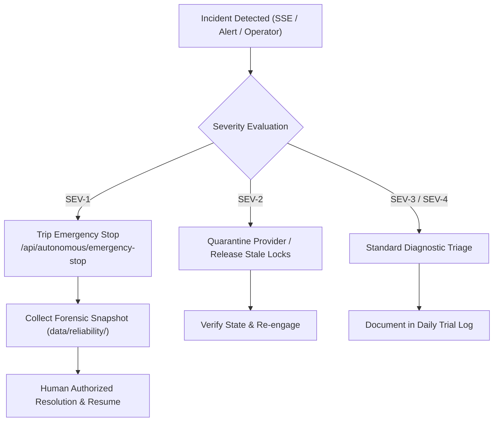

# My Office Phase 5.1 — Operational Incident Response Runbook

**Version:** 1.0.0  
**Target Audience:** My Office System Operators & Trial Engineers  
**Applicability:** 7-Day Controlled Operational Trial & Production Support  
**Project Root:** `D:\somehting code\my-office`  

---

## 1. Incident Classification & Severity Levels

| Severity | Definition | Target Response | Escalation Path |
| :--- | :--- | :---: | :--- |
| **SEV-1 (Critical)** | System-wide outage, Emergency Stop active, process identity violation / PID reuse hazard, active data corruption, or breach of repository boundaries (`XUONGPHIM`, `AI Video Tool`). | $< 5\text{ minutes}$ | Immediate halt; Trial Lead notified; operations paused. |
| **SEV-2 (High)** | Single provider unresponsive, in-flight concurrency lock contention, recovery budget exhausted, or unverified startup orphans blocking task completion. | $< 15\text{ minutes}$ | Operations Engineer investigates; self-healing throttled. |
| **SEV-3 (Medium)** | Degraded p95 latency ($>15\text{s}$), elevated remediation retry rate ($>25\%$), single subtask gate failure, or stale approval queue ($>60\text{m}$). | $< 1\text{ hour}$ | Normal operator triage; logs inspected. |
| **SEV-4 (Low)** | Minor telemetry reporting gaps, transient provider network hiccup, or non-blocking UI drawer rendering delay. | Next business day | Logged to tracking backlog. |

---

## 2. Emergency Escalation Hierarchy



---

## 3. Incident Response Playbooks

---

### Playbook 1: Process Identity Mismatch & PID Reuse Alert (`PID_REASSIGNED_DETECTED`)

- **Trigger:** Process supervisor logs `SECURITY_ABORT` or returns status `reassigned_detected` when evaluating a process termination.
- **Root Cause:** A child process exited and the operating system recycled its PID to an unrelated host process.
- **Immediate Invariant:** **NEVER issue a kill command to an unverified PID.**
- **Action Steps:**
  1. Inspect the alert detail via `/api/reliability/processes`:
     ```bash
     curl -s http://127.0.0.1:4310/api/reliability/processes
     ```
  2. Identify the recorded process fingerprint vs current OS process table:
     * Check expected executable path and start time in `data/reliability/processes.json`.
  3. Mark the tracked process record as `unverified_stale` via `/api/reliability/processes/:id/terminate` with query parameter `?action=abandon`.
  4. Verify that the unrelated OS process remains unharmed.
  5. Transition the associated execution in Control Manager to `failed` (`PROCESS_IDENTITY_MISMATCH`).

---

### Playbook 2: In-Flight Concurrency Lock Contention (`HTTP 409 Storm`)

- **Trigger:** Repeated client dispatch or approval requests fail with `HTTP 409 Conflict` (`CONCURRENT_REQUEST_IN_FLIGHT`).
- **Root Cause:** A client is submitting duplicate requests while an operation is actively executing, or a prior operation crashed without releasing its in-flight lock.
- **Action Steps:**
  1. Check in-flight idempotency locks:
     ```bash
     curl -s http://127.0.0.1:4310/api/reliability/idempotency/lock
     ```
  2. Determine whether the original request is genuinely executing or stale:
     * If execution is active: wait for normal completion; client should respect `Retry-After: 2`.
     * If execution process has already exited: release the stale lock:
     ```bash
     curl -X POST http://127.0.0.1:4310/api/reliability/idempotency/release -H "Content-Type: application/json" -d "{\"key\":\"<idempotency_key>\"}"
     ```
  3. Re-try the request with a fresh UUID.

---

### Playbook 3: Write-Ahead Log (WAL) Corruption / Torn-Write Alert

- **Trigger:** Server startup logs show corrupted bytes or `/api/reliability/health` reports `corruptRecordsCount > 0`.
- **Root Cause:** Hard system power cut or sudden crash during an active disk append operation.
- **Action Steps:**
  1. Inspect WAL health status:
     ```bash
     curl -s http://127.0.0.1:4310/api/reliability/journal
     ```
  2. Verify that automatic torn-write truncation occurred cleanly:
     * Confirm `data/reliability/execution.wal` was truncated to the last valid byte offset.
     * Confirm corrupted trailing bytes were saved to `data/reliability/execution.wal.corrupt.bak`.
  3. Verify cryptographic SHA-256 hash chaining:
     * If the hash chain is valid up to head sequence: system is healthy; continue normal operations.
     * If a mid-log record was tampered with: trigger Disaster Recovery Restore (Playbook 7).
  4. Archive the `.corrupt.bak` file to the trial forensics directory.

---

### Playbook 4: Unverified Startup Orphan (`outcome_unknown`)

- **Trigger:** Server reboot finds in-flight executions from the previous session.
- **Root Cause:** Server crashed or was killed while agents were dispatching or running.
- **Immediate Invariant:** **Blind redispatch is strictly forbidden.**
- **Action Steps:**
  1. Fetch startup reconciliation report:
     ```bash
     curl -s http://127.0.0.1:4310/api/reliability/reconcile/report
     ```
  2. Inspect executions marked `outcome_unknown` or `manual_reconciliation_required`.
  3. Determine real-world state of deliverables:
     * Check if working directory contains expected artifacts (e.g., git diff, output files).
     * If artifacts are complete: resolve as `completed`:
       ```bash
       curl -X POST http://127.0.0.1:4310/api/reliability/reconcile/<id>/resolve -H "Content-Type: application/json" -d "{\"resolution\":\"mark_completed\",\"notes\":\"Artifacts verified on disk\"}"
       ```
     * If work was aborted or damaged: resolve as `failed` and manually schedule fresh dispatch:
       ```bash
       curl -X POST http://127.0.0.1:4310/api/reliability/reconcile/<id>/resolve -H "Content-Type: application/json" -d "{\"resolution\":\"mark_failed\",\"notes\":\"Aborted during crash\"}"
       ```

---

### Playbook 5: Autonomous Loop Runaway / Budget Exhaustion

- **Trigger:** Remediation retry loop halts with `BUDGET_EXHAUSTED` or `LOOP_BREAKER_TRIGGERED`.
- **Root Cause:** An agent is trapped in a failing fix cycle (e.g., repeated syntax error or broken test).
- **Action Steps:**
  1. Inspect interventions list:
     ```bash
     curl -s http://127.0.0.1:4310/api/autonomous/interventions
     ```
  2. Review the 3 consecutive error signatures recorded in the loop breaker log.
  3. Review the current budget spend via `/api/autonomous/budget`.
  4. Options for Operator Resolution:
     * If issue is a simple typo/environment fix: fix the file manually, then resolve intervention:
       ```bash
       curl -X POST http://127.0.0.1:4310/api/autonomous/approvals/<id>/resolve -H "Content-Type: application/json" -d "{\"decision\":\"approved\",\"justification\":\"Manual fix applied\"}"
       ```
     * If budget is genuinely insufficient: increase limit with documented authorization:
       ```bash
       curl -X POST http://127.0.0.1:4310/api/autonomous/budget/update -H "Content-Type: application/json" -d "{\"maxCostUsd\":15.0,\"maxSubtasks\":35,\"authorizedBy\":\"trial-lead\"}"
       ```
     * If task is unviable: cancel the Master Task.

---

### Playbook 6: Emergency Stop Activation & Authorized Resumption

- **Trigger:** Operator clicks the Emergency Stop button (`#btn-estop`) or POSTs to `/api/autonomous/emergency-stop`.
- **System State:** System enters `state: 'halted'`. All dispatches are blocked immediately. Running child processes receive cancellation signals.
- **Action Steps for Resumption:**
  1. Ensure the underlying hazard (e.g., runaway process, incorrect directory target) is completely neutralized.
  2. Verify all active executions have confirmed cancellation:
     ```bash
     curl -s http://127.0.0.1:4310/api/autonomous/status
     ```
  3. Resume system using verified human operator credentials (minimum 5-character reason):
     ```bash
     curl -X POST http://127.0.0.1:4310/api/autonomous/emergency-stop/reset -H "Content-Type: application/json" -d "{\"authorizedBy\":\"operator-alice\",\"reason\":\"Workspace verified clean, hazard resolved\"}"
     ```
  4. Verify system returns to `state: 'idle'`.

---

### Playbook 7: Sandboxed Backup Verification & Disaster Recovery Restore

- **Trigger:** Critical state corruption or operator command to roll back to a known point-in-time snapshot.
- **Action Steps:**
  1. List available snapshots:
     ```bash
     curl -s http://127.0.0.1:4310/api/reliability/backups
     ```
  2. Select target `backupId` and run isolated sandboxed dry-run verification:
     ```bash
     curl -X POST http://127.0.0.1:4310/api/reliability/backups/<backupId>/verify
     ```
  3. Verify that the response returns `ok: true` and `status: "verified_restore_ok"`.
  4. If sandboxed restore succeeds and full restore is approved:
     * Stop the running server: terminate process.
     * Execute atomic restore script:
       ```bash
       node -e "import('./server/reliability/backup-manager.mjs').then(m => m.createBackupManager().restoreFromBackup('<backupId>'))"
       ```
     * Restart server: `node server/index.mjs`.
  5. Verify system health at `GET /health` and `/api/reliability/health`.

---

### Playbook 8: Quality Gate Blocker on Master Task Completion

- **Trigger:** Master Task reaches `in_review` but cannot transition to `succeeded` due to mandatory gate failure (`remediation_required`).
- **Root Cause:** Deliverables failed unit tests, typecheck, security invariant, or requirements coverage.
- **Action Steps:**
  1. Inspect gate evaluation findings:
     ```bash
     curl -s http://127.0.0.1:4310/api/qa/reviews/evaluate?masterTaskId=<masterTaskId>
     ```
  2. Identify specific failing gate (`functional`, `staticQuality`, `security`, `requirementCoverage`).
  3. Resolution Paths:
     * **Remediate:** Dispatch remediation subtask to fix the failing code/tests.
     * **Explicit Risk Acceptance:** If the failure is a known non-critical exception, authorized operator may waive the finding:
       ```bash
       curl -X POST http://127.0.0.1:4310/api/qa/findings/<findingId>/accept-risk -H "Content-Type: application/json" -d "{\"authorizedBy\":\"trial-lead\",\"justification\":\"Waiver granted for staging test fixture\"}"
       ```
  4. Re-evaluate quality gates: verify Master Task transitions to `succeeded`.

