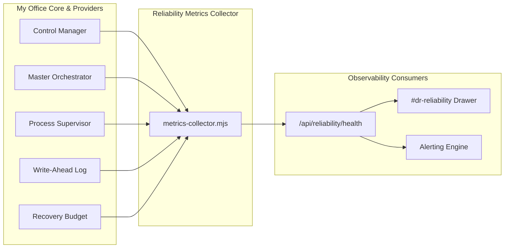

# My Office Phase 5.1 — Observability Metrics & Alerting Thresholds

**Version:** 1.0.0  
**Effective Scope:** 7-Day Controlled Operational Trial  
**Telemetry Endpoint:** `/api/reliability/health` & `/api/reliability/journal`  
**Strict Telemetry Principle:** *Real telemetry only. Missing or unmeasured data must remain null / unknown; data fabrication is strictly prohibited.*

---

## 1. Core Observability Metrics Specification

---

## 2. Telemetry Metrics Catalog & Mathematical Definitions

### 2.1 Execution & Task Health

| Metric Name | Identifier | Formula / Calculation | Collection Source | Default Sampling |
| :--- | :--- | :--- | :--- | :--- |
| **Task Success Rate** | `task_success_rate` | $\frac{N_{\text{succeeded}}}{N_{\text{total\_terminal}}} \times 100$ | `ControlManager.listExecutions()` | On completion event |
| **Task Failure Rate** | `task_failure_rate` | $\frac{N_{\text{failed}}}{N_{\text{total\_terminal}}} \times 100$ | `ControlManager.listExecutions()` | On completion event |
| **Stalled Executions** | `stalled_executions_count` | $\sum \mathbb{I}(\text{status} = \text{'running'} \land (t_{\text{now}} - t_{\text{last\_activity}} > T_{\text{stall}}))$ | `MetricsCollector.getStalledExecutions()` | Every 30s |
| **Active Executions** | `active_executions_count` | $\sum \mathbb{I}(\text{status} \in \{\text{'dispatching'}, \text{'running'}\})$ | `ControlManager.listExecutions()` | Real-time |

*Note on Stall Threshold ($T_{\text{stall}}$):* Default is $300\,\text{seconds}$ (5 minutes) without new hook, tool use, or stdout activity.

### 2.2 Process Identity & OS Table Supervision

| Metric Name | Identifier | Formula / Calculation | Collection Source | Default Sampling |
| :--- | :--- | :--- | :--- | :--- |
| **Tracked Processes** | `process_tracked_count` | $|\text{trackedProcesses}|$ | `ProcessSupervisor.listTrackedProcesses()` | Every 15s |
| **Orphan Processes** | `process_orphan_count` | $\sum \mathbb{I}(\text{state} = \text{'orphan\_detected'})$ | `ProcessSupervisor.reconcileStartupProcesses()` | Startup & hourly |
| **Reassigned PIDs** | `process_reassigned_count` | $\sum \mathbb{I}(\text{state} = \text{'reassigned\_detected'})$ | Process Supervisor before signaling | On termination trigger |

### 2.3 Latency & Duration Percentiles

Percentiles are computed mathematically over completed executions within the rolling 24-hour observation window:

$$\text{Sort durations: } D = [d_1, d_2, \dots, d_n] \text{ where } d_i \le d_{i+1}$$
$$p50 = D[\lceil 0.50 \times n \rceil]$$
$$p95 = D[\lceil 0.95 \times n \rceil]$$

*Truth Invariant:* If $n = 0$, $p50$ and $p95$ must return `null` (displayed as `None recorded`), never $0\text{ms}$.

### 2.4 Self-Healing, Remediation & Budget Consumption

| Metric Name | Identifier | Formula / Calculation | Collection Source |
| :--- | :--- | :--- | :--- |
| **Remediation Rate** | `remediation_rate` | $\frac{N_{\text{remediation\_triggers}}}{N_{\text{subtasks\_executed}}} \times 100$ | `AutonomousScheduler.getRemediationHistory()` |
| **Loop Breaker Halts**| `loop_breaker_halts` | Count of 3-consecutive error escalations | `AutonomousScheduler.getInterventions()` |
| **Budget Spend USD** | `budget_cost_usd` | Sum of tracked task costs in USD | `RecoveryBudgetTracker.getBudgetSummary()` |
| **Budget Remaining USD**| `budget_remaining_usd` | $C_{\text{max\_usd}} - C_{\text{spent\_usd}}$ | `RecoveryBudgetTracker.getRemaining()` |

### 2.5 Durability, WAL & Backup Health

| Metric Name | Identifier | Formula / Calculation | Collection Source |
| :--- | :--- | :--- | :--- |
| **WAL Sequence Head** | `wal_sequence_head` | Highest contiguous monotonic sequence $S_{\text{head}}$ | `Journal.getJournalStats().currentSequence` |
| **WAL File Size** | `wal_bytes` | File size on disk in bytes | `fs.statSync('execution.wal').size` |
| **Corrupt WAL Records**| `wal_corrupt_count` | Count of unparseable/truncated records recovered | `Journal.getJournalStats().corruptRecordsCount` |
| **Last Fsync Epoch** | `wal_last_fsync_ms` | Timestamp of most recent synchronous disk flush | `Journal.getJournalStats().lastFsyncTimestamp` |
| **Backup Integrity** | `backup_verified_ratio`| $\frac{N_{\text{verified\_ok}}}{N_{\text{total\_backups}}} \times 100$ | `BackupManager.listBackups()` |

---

## 3. Operational Thresholds & Alert Matrix

Every metric is monitored against three operational bands:
- **Nominal (Green):** Normal system behavior.
- **Warning (Yellow):** Degraded operation; operator investigation recommended.
- **Critical (Red):** Severe malfunction or breach of invariant; immediate operator intervention or automated trip.

| Metric | Nominal (Green) | Warning (Yellow) | Critical (Red) | Automated Action / Escalation |
| :--- | :---: | :---: | :---: | :--- |
| **Task Success Rate** | $\ge 95.0\%$ | $85.0\% - 94.9\%$ | $< 85.0\%$ | Alert operator; evaluate provider status |
| **Stalled Executions** | $0$ | $1 - 2$ | $\ge 3$ | Flag for investigation; cancel after 10m |
| **Orphan Child PIDs** | $0$ | $1 - 2$ | $\ge 3$ | Quarantine child PIDs; trigger reconciliation |
| **Reassigned PIDs** | $0$ | $0$ | $\ge 1$ | **SECURITY_ABORT**: Block termination immediately |
| **Execution p95 Latency**| $\le 5,000\text{ms}$ | $5,001 - 15,000\text{ms}$ | $> 15,000\text{ms}$ | Inspect agent CLI responsiveness |
| **Remediation Rate** | $\le 10.0\%$ | $10.1\% - 25.0\%$ | $> 25.0\%$ | Check for systemic workspace defects |
| **Loop Breaker Halts** | $0$ | $1 - 2$ | $\ge 3$ | Halt autonomous scheduler; require human approval |
| **Recovery Budget Spend**| $< 70\%$ limit | $70\% - 89\%$ limit | $\ge 90\%$ limit | Throttle new dispatches; block at $100\%$ |
| **Approval Queue Age** | $\le 15\text{m}$ | $16 - 60\text{m}$ | $> 60\text{m}$ | Escalate reminder; expire after 24h |
| **Corrupt WAL Records**| $0$ | $0$ | $\ge 1$ | Snapshot `.corrupt.bak`; alert operator |
| **Backup Verification** | $100\%$ | $100\%$ | $< 100\%$ | Mark backup corrupt; generate fresh snapshot |
| **Emergency Stop Status**| `idle` | `recovering` | `halted` | Dispatches blocked; operator action required |

---

## 4. Telemetry Ingestion & Polling Rules

1. **Client Polling Interval:**  
   The Reliability Drawer (`#dr-reliability`) polls `GET /api/reliability/health` every **5,000ms** while open, and terminates the interval immediately upon closing.
2. **Server-Sent Events (SSE):**  
   Critical alerts (`EMERGENCY_STOP_TRIGGERED`, `SECURITY_INVARIANT_VIOLATION`, `BUDGET_EXHAUSTED`, `CORRUPT_RECORD_DETECTED`) push immediately across `/event` SSE streams to connected clients.
3. **Missing Value Invariant:**  
   If an external provider (e.g., Antigravity IDE) has no reported latency data, the metric value must serialize as `null` or `'unknown'`. Telemetry collectors must never default unmeasured durations to `0` or approximate values.

