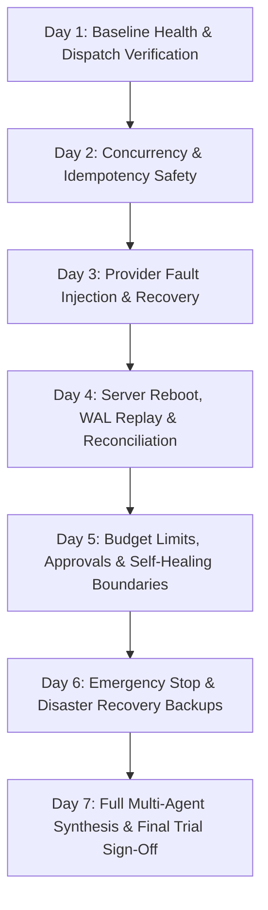

# My Office Phase 5.1 — Controlled 7-Day Operational Trial Plan

**Version:** 1.0.0  
**Status:** APPROVED FOR EXECUTION  
**Effective Date:** 2026-11-13 to 2026-11-20  
**Project Root:** `D:\somehting code\my-office`  
**Trial Coordinator:** Human Operations Lead & My Office Coordinator  

---

## 1. Objectives & Guarantees

The objective of the **7-Day Operational Trial** is to observe, validate, and measure the real-world operational reliability of My Office under normal development workflows and controlled fault-injection probes.

### Operational Safety Invariants (Strictly Enforced)

1. **Autonomy Tier Locked at `supervised`:**  
   The platform will run in `supervised` autonomy mode throughout all 7 days. Unattended `autonomous` mode is strictly prohibited.
2. **Mandatory Human Approvals:**  
   Destructive operations, file deletions, git rollbacks, and budget increases require explicit human approval via `/api/autonomous/approvals/:id/resolve` or the UI Approval Center.
3. **Emergency Stop Authority:**  
   The Emergency Stop mechanism (`/api/autonomous/emergency-stop`) remains 100% authoritative. When tripped, all provider dispatches are blocked immediately and child processes are terminated. Resumption requires authenticated human credentials.
4. **Anti-Blind-Redispatch Invariant:**  
   Any execution found interrupted upon server reboot is classified as `outcome_unknown` or `manual_reconciliation_required`. Blind automatic redispatch is strictly blocked.
5. **No Destructive Operations on Production Data:**  
   All fault injections, recovery tests, and load runs must execute in synthetic test directories (`tests/fixtures/trial-*` or `os.tmpdir()`). Active production files in `data/` must not be tampered with.
6. **External Project Isolation:**  
   Under no circumstances may any test or agent execute commands or edit files in `D:\somehting code\xuongphim` (XUONGPHIM) or `D:\videoaitool` (AI Video Tool).
7. **Git Safety:**  
   Zero unauthorized git commits or branch rebases will be performed during the trial.

---

## 2. Daily Trial Progression Schedule

---

### Day 1 — Baseline Health & Normal Task Dispatch
- **Objective:** Verify stable runtime operation, hook ingestion, and basic single-agent workflows.
- **Test Procedures:**
  1. Boot server: `node server/index.mjs` on port 4310.
  2. Verify `/api/reliability/health` reports status `healthy` with 0 orphans and 0 corrupt records.
  3. Dispatch single Claude Code task via Control Manager:
     * Endpoint: `POST /api/control/dispatch`
     * Payload: `{ agentId: 'claude-code', workingDirectory: 'tests/fixtures', instruction: 'Audit readme' }`
  4. Verify execution status transitions: `queued` $\to$ `running` $\to$ `succeeded`.
  5. Inspect Activity Center timeline: verify 1 primary task card aggregated across prompt, tool use, and exit events.
- **Pass Criteria:** 100% task success rate on valid dispatches; zero unhandled errors in `server.out.log`.

---

### Day 2 — Multiple Concurrent Agents & Idempotency Locks
- **Objective:** Verify safe parallel execution and duplicate dispatch prevention under concurrent load.
- **Test Procedures:**
  1. **Concurrency Throttling:**
     * Create Master Task with 6 subtasks (3 Claude Code, 3 Codex CLI).
     * Verify Master Orchestrator executes exactly 3 subtasks concurrently (`maxConcurrentSubtasks = 3`).
     * As subtasks complete, verify pending subtasks are dispatched in FIFO topological order.
  2. **Scoped Idempotency Protection:**
     * Send two identical dispatch requests within 10ms with header `Idempotency-Key: operator-1:dispatch:uuid-test-001`.
     * Request 1 must return `200 OK` (or `202 Accepted`) and acquire in-flight lock.
     * Request 2 must immediately return `409 Conflict` with header `Retry-After: 2` (`CONCURRENT_REQUEST_IN_FLIGHT`).
     * After Request 1 completes, repeat Request 2: verify cached response is returned without re-dispatching child process.
- **Pass Criteria:** Zero double-dispatches; concurrency never exceeds configured bounds.

---

### Day 3 — Provider Failure, Timeouts & Process Escalation Ladder
- **Objective:** Verify system resilience when underlying agent CLIs crash, freeze, or reject requests.
- **Test Procedures:**
  1. **CLI Timeout Simulation:**
     * Dispatch task to a mock/hanging CLI process that ignores `SIGTERM`.
     * Request cancellation via `POST /api/control/executions/:id/cancel`.
     * Verify Process Supervisor initiates graceful signaling (`SIGTERM`), waits for grace period (5000ms), and cleanly escalates to forceful termination (`SIGKILL` / `taskkill /F /T`).
     * Verify process status updates to `terminated_forced` and child process disappears from OS process table.
  2. **Process Identity Safety (Anti-PID-Reuse):**
     * Manually unbind process from supervisor store and attempt termination against an arbitrary OS PID.
     * Verify supervisor detects fingerprint mismatch and halts with `PID_REASSIGNED_DETECTED` (`SECURITY_ABORT`).
- **Pass Criteria:** 100% termination success on frozen agents; zero terminations of unverified PIDs.

---

### Day 4 — Server Reboot, WAL Replay & Orphan Reconciliation
- **Objective:** Verify complete crash recovery and state consistency after sudden server shutdown.
- **Test Procedures:**
  1. Dispatch 2 parallel long-running subtasks.
  2. While processes are actively running, abruptly kill the server process (`taskkill /F /PID <server_pid>`).
  3. Inject a torn write into `data/reliability/execution.wal` (append 15 bytes of truncated JSON).
  4. Restart server: `node server/index.mjs`.
  5. Inspect startup logs and `/api/reliability/health`:
     * Verify WAL auto-truncates torn bytes to last valid sequence and preserves corrupted bytes in `.corrupt.bak`.
     * Verify Reconciliation Engine audits interrupted runs.
     * Verified child processes still running are mapped; unacked runs are classified as `outcome_unknown`.
     * Verify **anti-blind-redispatch invariant**: interrupted tasks remain in `waiting` intervention queue and are **not** re-dispatched automatically.
- **Pass Criteria:** Server boots cleanly; 0 data corruption crashes; intervention queue populated truthfully.

---

### Day 5 — Budget Exhaustion, Approvals & Self-Healing Loop Breakers
- **Objective:** Verify operational constraints, financial budget guards, and human approval gates.
- **Test Procedures:**
  1. **Recovery Budget Cap:**
     * Set `maxSubtasks: 5` and `maxCostUsd: 1.0` in `data/autonomous/budget-state.json`.
     * Run orchestration generating 6 subtasks.
     * Verify Subtask 6 is blocked with `BUDGET_EXHAUSTED` and logged to audit trail.
  2. **Human Approval Lifecycle:**
     * Trigger action requiring approval (e.g., `destructive_operation` or `budget_override`).
     * Verify task halts with `APPROVAL_PENDING`.
     * Resolve via `POST /api/autonomous/approvals/:id/resolve` with `{ decision: 'rejected' }`.
     * Verify task transitions to `cancelled` and records operator audit record.
  3. **Self-Healing Loop Breaker:**
     * Introduce a persistent compilation error in a synthetic workspace.
     * Observe Autonomous Scheduler remediation loop.
     * Verify scheduler halts after 3 identical consecutive error signatures and escalates to human operator.
- **Pass Criteria:** System strictly prevents runaway autonomous retries or financial quota overages.

---

### Day 6 — Emergency Stop & Sandboxed Disaster Recovery
- **Objective:** Verify instantaneous emergency shutdown and isolated multi-store backup restore.
- **Test Procedures:**
  1. **Emergency Stop Circuit Breaker:**
     * Trip Emergency Stop: `POST /api/autonomous/emergency-stop` with `{ reason: 'Trial Drill Day 6' }`.
     * Verify all subsequent dispatch attempts throw `EmergencyStopActiveError` synchronously.
     * Verify all active provider runs receive cancellation requests and transition to `cancellation_confirmed`.
     * Attempt automated resume: verify system rejects non-human caller.
     * Resume with human credentials: `POST /api/autonomous/emergency-stop/reset` with `{ authorizedBy: 'trial-lead', reason: 'Drill complete' }`.
     * Verify system resets to `state: 'idle'`.
  2. **Consistent Snapshot & Sandboxed Restore:**
     * Trigger snapshot: `POST /api/reliability/backups/create`.
     * Verify snapshot manifest contains all JSON stores + WAL offset with SHA-256 checksums.
     * Trigger sandboxed dry-run restore: `POST /api/reliability/backups/:id/verify`.
     * Verify restore extracts into `os.tmpdir()/dr-verify-*`, validates all checksums, and leaves production `data/` untouched.
- **Pass Criteria:** Instantaneous dispatch halt; 100% dry-run backup verification pass.

---

### Day 7 — Full Multi-Agent Synthesis & Final Trial Sign-Off
- **Objective:** End-to-end execution of a complex multi-agent Master Task requiring dependency handoffs, quality gates, and live observability telemetry.
- **Test Procedures:**
  1. Create Master Task with 4 dependent subtasks across Claude Code and Codex CLI.
  2. Verify handoff context passing between subtask outputs and dependent inputs.
  3. Run QA Quality Gate review upon completion:
     * Functional Gate: Unit test evidence checked.
     * Static Gate: Typecheck clean.
     * Security Gate: Zero unresolved high/critical vulnerabilities.
     * Coverage Gate: Deliverables verified against requirements.
  4. Verify Master Task transitions to `succeeded` only after all 4 gates pass.
  5. Inspect Reliability Drawer (`#dr-reliability`): verify p50/p95 latency metrics, uptime counter, and telemetry counters reflect exact execution history.
- **Pass Criteria:** Successful end-to-end synthesis; zero unhandled errors across all 7 trial days.

---

## 3. Trial Entry, Exit & Suspension Criteria

| Gate | Requirement | Verification Method |
| :--- | :--- | :--- |
| **Entry Criteria** | Multi-phase regression (87/87) passed, smoke test passed, all stores healthy. | Automated check prior to Day 1 start. |
| **Suspension Criteria** | Unverified process kill, data store corruption, or blind redispatch event. | Automatic trip to Emergency Stop + operator alert. |
| **Exit Criteria** | 7 consecutive days completed with 0 SEV-1 incidents and $\ge 99.5\%$ task dispatch reliability. | Review of 7-day telemetry logs and operator sign-off. |

