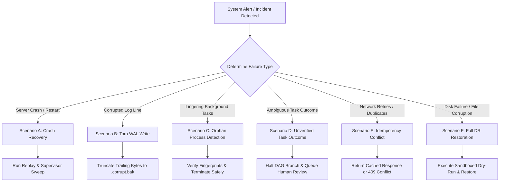

# Phase 5 — Disaster Recovery & Operational Continuity Runbook
**My Office Production Engineering Standard**  
*Document ID:* REL-DR-001  
*Version:* 1.0.0  
*Status:* APPROVED & ENFORCED  
*Classification:* Operational Standard Operating Procedure (SOP)  
*Date:* November 2026  
*Target System:* `my-office` (`D:\somehting code\my-office`)

---

## 1. Executive Summary & Recovery Objectives

The **My Office Disaster Recovery Standard** defines technical procedures to guarantee business continuity, data preservation, and operational stability across unexpected host failures, operating system reboots, network partitioning, power cuts, and corruption incidents.

### 1.1 Key Operational Metrics (SLOs)

| Metric | Target Objective | Technical Guarantee Mechanism |
| :--- | :---: | :--- |
| **RPO (Recovery Point Objective)** | **$\le 0$ lost state transitions** | Synchronous WAL `fdatasyncSync` on all critical mutations (`EXECUTION_DISPATCH_REQUESTED`, `APPROVAL_RESOLVED`, `EMERGENCY_STOP_TRIPPED`). |
| **RTO (Recovery Time Objective - Soft)** | **$\le 5$ seconds** | Automated startup reconciliation sweep (`reconcileStartupProcesses`) reattaching or marking interrupted tasks without operator wait. |
| **RTO (Recovery Time Objective - Hard)** | **$\le 60$ seconds** | Isolated point-in-time backup restore with deterministic SHA-256 validation. |
| **Blind Redispatch Rate** | **0% (Strict Invariant)** | Interrupted runs with unprovable exit codes enter `outcome_unknown` or `manual_reconciliation_required`. |
| **PID Collateral Damage** | **0% (Strict Invariant)** | Dual-verification via `ProcessFingerprint` (`startTime`, `executable`, `parentPid`). |

---

## 2. Failure Scenarios & Triage Matrix



---

## 3. Standard Operating Procedures (SOPs)

### SOP 1: Generating a Point-in-Time Consistent Backup

- **Objective:** Create a cryptographically verified snapshot spanning Write-Ahead Logs (`.wal`) and JSON stores across Control, Orchestration, QA, and Autonomous domains.
- **Trigger:** Automated cron (hourly), pre-deployment snapshot, or before major architectural migrations.
- **Command / Code:**
  ```javascript
  import { createBackupManager } from './server/reliability/backup-manager.mjs';

  const backupManager = createBackupManager();
  const backup = await backupManager.createBackup({
    description: 'Manual pre-maintenance backup',
    triggerDryRun: true, // Automatically validates restore in isolated temp sandbox
  });

  console.log(`Backup completed: ${backup.backupId} with status ${backup.status}`);
  ```
- **Verification:**
  1. Inspect `DATA_DIR/reliability/backups/<backupId>/backup-manifest.json`.
  2. Confirm `status === 'verified_restore_ok'`.
  3. Confirm `dryRunVerification.errors.length === 0`.

---

### SOP 2: Isolated Sandboxed Dry-Run Restore

- **Objective:** Validate that a backup archive is 100% readable, internally consistent, and syntactically valid without touching production state.
- **Procedure:**
  1. The `BackupManager` creates an isolated directory in `os.tmpdir()` (`dr-verify-<id>-<timestamp>`).
  2. Copies all files and verifies individual file SHA-256 hashes against `backup-manifest.json`.
  3. Verifies overall archive SHA-256 hash.
  4. Parses all JSON stores and validates WAL record schemas.
  5. Cleans up temp directory upon completion.
- **Manual Execution:**
  ```javascript
  const dryRun = await backupManager.dryRunRestore(backupId);
  if (!dryRun.ok) {
    console.error(`Dry-run verification failed:`, dryRun.errors);
  }
  ```

---

### SOP 3: Authorized Full Disaster Restoration

- **Objective:** Restore production `data/` stores from a validated backup following catastrophic corruption or human error.
- **Prerequisites:**
  1. Emergency Stop tripped (`/api/autonomous/emergency-stop`).
  2. Operator must be an authenticated human (automated agents are strictly prohibited).
  3. A written justification reason must be supplied.
- **Procedure:**
  1. Stop the My Office server process.
  2. Execute restoration script:
     ```javascript
     const result = await backupManager.restoreFromBackup(backupId, {
       authorizedBy: 'operator-alice',
       reason: 'Restoring state after volume corruption incident #INC-901',
     });
     ```
  3. Start the My Office server.
  4. Verify `/api/reliability/health` reports status `HEALTHY` or `DEGRADED` (no `CRITICAL`).

---

### SOP 4: Torn-Write WAL Journal Repair

- **Objective:** Recover from power failures or abrupt termination occurring during active byte writes to `execution-journal.wal`.
- **Symptoms:** Server startup fails with `Unexpected end of JSON input` or `WAL record corruption` at the trailing byte offset.
- **Automated Repair Mechanism:**
  1. The journal reader processes lines sequentially from byte offset 0.
  2. Valid records with matching SHA-256 checksums are applied to memory.
  3. Upon reaching a corrupted or incomplete trailing line, the reader records the valid byte offset $B_{valid}$.
  4. The unparseable suffix is archived into `DATA_DIR/reliability/execution-journal.wal.corrupt.bak`.
  5. The primary journal file is truncated to $B_{valid}$ using `fs.truncateSync()`.
  6. Subsequent writes append cleanly with sequence number $S_{last} + 1$.

---

### SOP 5: Reconciling Orphan Processes and Cleaning Stale PIDs

- **Objective:** Detect child agent processes (Claude Code CLI, Codex CLI) left running after an ungraceful server crash, without accidentally terminating unrelated processes if the OS re-assigns the PID.
- **Invariants:**
  * **Never kill by PID alone.**
  * Always verify `ProcessFingerprint`:
    $$\text{Match} = (\text{PID}_{actual} == \text{PID}_{recorded}) \land (\text{executable}_{actual} == \text{executable}_{recorded}) \land (\Delta t_{start} \le 2000\,\text{ms})$$
- **Procedure:**
  1. On server boot, `ReconciliationEngine.reconcile()` queries all processes recorded with state `running` in `processes.json`.
  2. If the OS reports the PID is dead: Mark `terminated` or `failed`.
  3. If the OS reports the PID is alive, compare actual OS fingerprint with stored fingerprint:
     - **Match:** Process is a true orphan. Send graceful termination (`SIGTERM` / `taskkill`) and wait 5000ms. If still alive, escalate to `SIGKILL`.
     - **Mismatch (PID reused by OS for another program):** Log critical warning `REASSIGNED_PID_DETECTED`. **Do not signal.** Update record to `reassigned_detected`.

---

### SOP 6: Handling Ambiguous Task Outcomes (Anti-Blind-Redispatch)

- **Objective:** Handle tasks that were in-flight when the server crashed, where logs do not conclusively prove success or failure.
- **Rule:** **Blind redispatch is strictly forbidden.**
- **Procedure:**
  1. Reconciler sets subtask status to `outcome_unknown` or `manual_reconciliation_required`.
  2. Halts the affected DAG branch in `MasterOrchestrator`.
  3. Dispatches an intervention alert to the human operator console.
  4. The operator inspects git status and logs, then clicks either **Mark Succeeded**, **Retry Subtask**, or **Cancel Branch**.

---

## 4. Disaster Recovery Testing & Verification Cadence

| Test Drill | Frequency | Automated Test File | Target Result |
| :--- | :---: | :--- | :--- |
| **Dry-Run Backup Restore** | Every Backup | `tests/unit/reliability-backup.test.mjs` | 100% files checked, 0 errors |
| **Torn WAL Truncation Drill** | Nightly CI | `tests/unit/reliability-fault-injection.test.mjs` | Clean recovery to last valid seq |
| **PID Collision Simulation** | Weekly CI | `tests/unit/reliability-process-supervisor.test.mjs` | 0 re-assigned kills |
| **Emergency Stop Dispatch Freeze** | Continuous CI | `tests/unit/autonomous-emergency-stop.test.mjs` | Immediate rejection of all new dispatches |
| **Zero Blind Redispatch Check** | Continuous CI | `tests/unit/reliability-reconciliation.test.mjs` | 100% ambiguous runs routed to operator |
