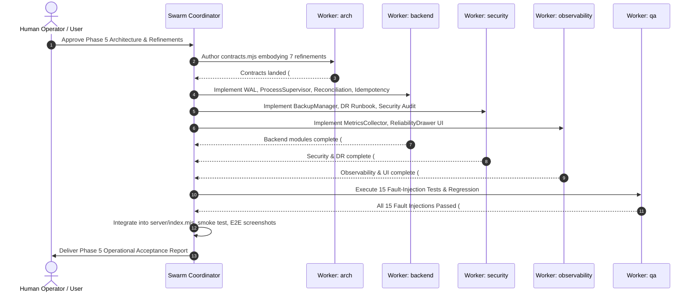

# Phase 5 — Production Reliability, Observability & Disaster Recovery Architecture
**My Office Operational Assurance Specification**  
*Document ID:* REL-ARCH-001  
*Version:* 1.0.0  
*Status:* APPROVED & ENFORCED  
*Date:* November 2026  
*Target Repository:* `my-office` (`D:\somehting code\my-office`)

---

## 1. Architectural Vision & Scope

Phase 5 introduces a production-grade operational assurance layer on top of **Phase 1 (Control Center)**, **Phase 2 (Multi-Agent Task Orchestration)**, **Phase 3 (QA & Quality Gates)**, and **Phase 4 (Autonomous Operations Platform)**.

The objective is to ensure that My Office survives real-world operating system failures, unexpected Node.js restarts, network partitioning, process crashes, and disk latency without:
1. Losing execution history or in-flight state.
2. Abandoning untracked OS child processes.
3. Permitting double-spending of token/cost budgets.
4. Spawning duplicate executions from network retries.
5. Blindly redispatching tasks whose prior outcomes are unknown.
6. Bypassing mandatory Phase 3 Quality Gates or Phase 4 Security Invariants.

---

## 2. Seven Mandatory Design Refinements

### Refinement 1: Process Identity Safety
- **Core Rule:** *A Process ID (PID) alone is NEVER sufficient to establish process identity or issue termination signals.*
- **Process Fingerprint Schema:**
  ```typescript
  interface ProcessFingerprint {
    pid: number;
    startTime: number;        // Epoch timestamp (ms) or OS tick count
    executable: string;       // Normalized executable path (e.g. node.exe, claude.cmd)
    commandLine: string;      // Full sanitized command line arguments
    parentPid: number;        // Parent process PID (must match My Office server PID)
    hostUser: string;         // OS user identity
  }
  ```
- **Validation Before Signaling:**
  Before sending any signal (`taskkill`, `SIGTERM`, `SIGKILL`), the `ProcessSupervisor` queries the OS process table (`Get-CimInstance Win32_Process` / `tasklist` / `wmic` on Windows, `ps -p <pid> -o pid,lstart,command` on POSIX).
  If PID matches but `startTime`, `commandLine`, or `executable` does not match the recorded fingerprint, **the process is considered re-assigned by the OS**. Signaling is strictly rejected, and an alert is recorded.

---

### Refinement 2: Idempotency & Concurrency Safety
- **Scoped Idempotency Keys:**
  Every mutation endpoint requires or validates an `Idempotency-Key` header with format:
  $$\text{Key} = \text{operatorId} : \text{endpoint} : \text{clientGeneratedUUID}$$
- **Behavior Matrix:**
  1. **New Key:** Lock acquired with atomic state `IN_PROGRESS`. Request executes. On completion, response is cached in the Idempotency Store (TTL: 24 hours), and state transitions to `RESOLVED`.
  2. **Duplicate Key (Completed):** Returns the cached HTTP response code, headers, and payload immediately without re-dispatching or re-executing.
  3. **Duplicate Key (In-Flight):** Returns HTTP `409 Conflict` with `code: 'CONCURRENT_REQUEST_IN_FLIGHT'` and a `Retry-After` header.
  4. **Missing Key:** Non-mutating GETs proceed without keys. Mutation requests without explicit `Idempotency-Key` derive an internal deterministic transaction key from the authenticated operator, endpoint, and payload SHA-256 hash, but log an idempotency warning. Distinct tasks with identical instructions from the user are NEVER conflated.

---

### Refinement 3: Durable Execution Write-Ahead Log (WAL)
- **Append-Only JSONL Architecture:**
  Every state transition is appended to `DATA_DIR/reliability/execution-journal.wal` before memory state is declared updated.
- **Record Structure:**
  ```json
  {
    "seq": 1042,
    "eventId": "evt-1731440000000-8f92a1",
    "timestamp": 1731440000000,
    "aggregateType": "subtask_execution",
    "aggregateId": "exec-92a1",
    "masterTaskId": "mt-101",
    "eventType": "EXECUTION_DISPATCHED",
    "payload": { "provider": "claude-code", "instructionHash": "sha256-..." },
    "idempotencyKey": "admin:/api/control/dispatch:uuid-101",
    "prevHash": "sha256-...",
    "checksum": "sha256-..."
  }
  ```
- **Durability & Flush Policy:**
  - Synchronous `fs.fdatasyncSync()` / `fsync` for critical transitions: `DISPATCH_REQUESTED`, `APPROVAL_RESOLVED`, `EMERGENCY_STOP_TRIPPED`, `CHECKPOINT_CREATED`.
  - Monotonic integer sequence validation: gaps or out-of-order sequences trigger recovery reconciliation.
  - Corrupted or partial trailing lines (e.g. from sudden power cut) are detected via SHA-256 / JSON parse validation, truncated to the last valid byte offset, and archived to `.corrupt.bak`.

---

### Refinement 4: Safe Orphan Reconciliation on Startup
- **State Machine for Interrupted Runs:**
  When My Office reboots, the `ReconciliationEngine` scans all active entries:
  ```mermaid
  stateDiagram-v2
      [*] --> StartupSweep
      StartupSweep --> ProcessVerification: Has recorded PID & Fingerprint
      StartupSweep --> OutcomeUnknown: No process fingerprint found
      
      ProcessVerification --> StillRunning: Verified OS PID matches Fingerprint
      ProcessVerification --> DefinitelyFailed: OS confirms process exited with non-zero
      ProcessVerification --> ManualReconciliationRequired: PID reused or OS unverifiable
      
      StillRunning --> ReattachSupervisor: Resume heartbeat & stdout monitor
      OutcomeUnknown --> OperatorInterventionQueue: Strictly BLOCKS blind redispatch
      ManualReconciliationRequired --> OperatorInterventionQueue
  ```
- **Invariants:**
  - An execution whose outcome cannot be proven is marked `outcome_unknown`.
  - **Blind redispatch is forbidden.** The system halts automatic execution on that DAG branch and requests human operator intervention.

---

### Refinement 5: Consistent Multi-Store Backup & Disaster Recovery
- **Snapshot Consistency Boundary:**
  Backups capture an atomic point-in-time state across:
  - `DATA_DIR/reliability/execution-journal.wal` (at recorded byte offset $B$ and sequence $S$)
  - `DATA_DIR/control/control-state.json`
  - `DATA_DIR/orchestration/master-orchestration.json`
  - `DATA_DIR/qa/reviews-and-findings.json`
  - `DATA_DIR/autonomous/*.json`
- **Integrity & Verification:**
  - Generates `backup-manifest.json` containing individual file SHA-256 hashes and an overall tarball SHA-256 checksum.
  - **Isolated Dry-Run Restore Test:** Restores the backup into a sandboxed temp directory (`tmp/dr-verify-<id>`), validates JSON parsability, verifies hash matching, and asserts DAG graph integrity without modifying production files.

---

### Refinement 6: Contract-First Architecture
All reliability data structures, event types, error codes, and state machines are declared in [server/reliability/contracts.mjs](file:///d:/somehting%20code/my-office/server/reliability/contracts.mjs) before implementation modules consume them.

---

### Refinement 7: Independent QA & Fault-Injection Verification
Worker deliverables must be independently verified by Worker 5 (QA) across all 15 mandatory fault-injection scenarios:
1. Server termination during journal write (torn write recovery).
2. Server termination during active agent execution.
3. Restart after dispatch but before provider acknowledgement.
4. Duplicate dispatch requests with same `Idempotency-Key`.
5. Duplicate approval requests.
6. Concurrent conflicting approval and rejection.
7. Emergency Stop during multiple active provider executions.
8. Provider timeout during cancellation.
9. Budget exhaustion during self-healing remediation.
10. Corrupted checkpoint file recovery.
11. Journal replay with duplicate events.
12. Orphan child process detection and reconciliation after server restart.
13. Concurrent scheduler workers attempting the same Subtask.
14. Isolated restore from backup with integrity validation.
15. QA Critical finding during Autonomous Mode.

---

## 3. Subsystem Specifications

### 3.1 Durable Execution Journal (`server/reliability/journal.mjs`)
- **Storage:** `DATA_DIR/reliability/journal.wal` (JSONL)
- **Checkpoints:** `DATA_DIR/reliability/checkpoints/checkpoint-<seq>.json`
- **Replay API:** `replayJournal({ fromSeq, toSeq, applyFn })` rebuilds in-memory models deterministically.

### 3.2 Process Supervisor (`server/reliability/process-supervisor.mjs`)
- **State Store:** `DATA_DIR/reliability/processes.json`
- **Capabilities:**
  - `registerProcess({ executionId, provider, childProcess, commandLine, workingDirectory })`
  - `verifyProcessLiveness(executionId)`
  - `reconcileStartupProcesses()`
  - `terminateProcessSafely(executionId, { gracePeriodMs = 5000, reason })`

### 3.3 Idempotency Engine (`server/reliability/idempotency.mjs`)
- **State Store:** `DATA_DIR/reliability/idempotency-cache.json`
- **Capabilities:**
  - `acquireLock(key, { ttlMs = 60000 })`
  - `recordResponse(key, { statusCode, body, headers })`
  - `lookupKey(key)`

### 3.4 Operational Health & Telemetry Dashboard (`server/reliability/metrics-collector.mjs`)
- **REST Surface:** `/api/reliability/health`, `/api/reliability/metrics`, `/api/reliability/backups`, `/api/reliability/reconcile`
- **Dashboard UI:** [src/components/office/ReliabilityDrawer.tsx](file:///d:/somehting%20code/my-office/src/components/office/ReliabilityDrawer.tsx) embedded in top navigation.

---

## 4. Swarm Team & Exclusive Ownership Mapping

| Swarm Worker | Role | Exclusive File Ownership | Responsibilities |
|---|---|---|---|
| **coordinator** | Lead Orchestrator | `server/index.mjs`, `TopBar.tsx`, `page.tsx`, `docs/PHASE_5_ACCEPTANCE_REPORT.md` | Integration of routes and drawers, contract gating, final multi-phase regression sign-off |
| **monitor** | Stall Monitor | Swarm Message Board | Deadlock detection and coordination unsticking |
| **arch** | Reliability Architect | `server/reliability/contracts.mjs`, `docs/PHASE_5_RELIABILITY_ARCHITECTURE.md` | Authoritative contracts, state machine definitions, schema validation |
| **backend** | Backend Reliability | `server/reliability/journal.mjs`, `server/reliability/reconciliation.mjs`, `server/reliability/process-supervisor.mjs`, `server/reliability/idempotency.mjs`, `server/reliability/reliability-api.mjs` | WAL engine, process supervisor with fingerprinting, reconciliation engine, idempotency middleware |
| **observability** | Observability & UI | `server/reliability/metrics-collector.mjs`, `src/components/office/ReliabilityDrawer.tsx`, `src/office/ui/reliability-view.js` | Genuine p50/p95 latency metrics, health collector, live Operational Health UI dashboard |
| **security** | Security & DR | `server/reliability/backup-manager.mjs`, `docs/PHASE_5_SECURITY_AUDIT.md`, `docs/PHASE_5_DISASTER_RECOVERY_RUNBOOK.md` | Consistent backup engine, sandboxed restore verification, threat modeling, security audit |
| **qa** | Verification & QA | `tests/unit/reliability-*.test.mjs`, `tests/e2e/reliability-dashboard-live.spec.ts` | 15 mandatory fault-injection suites, live browser E2E test, 0-regression validation |

---

## 5. Execution Sequence



