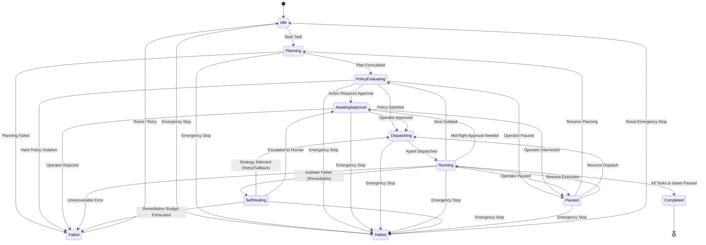
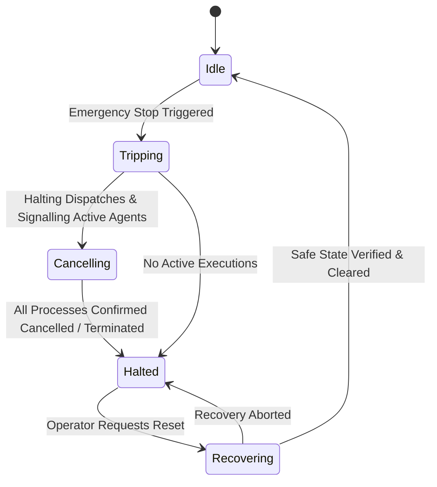
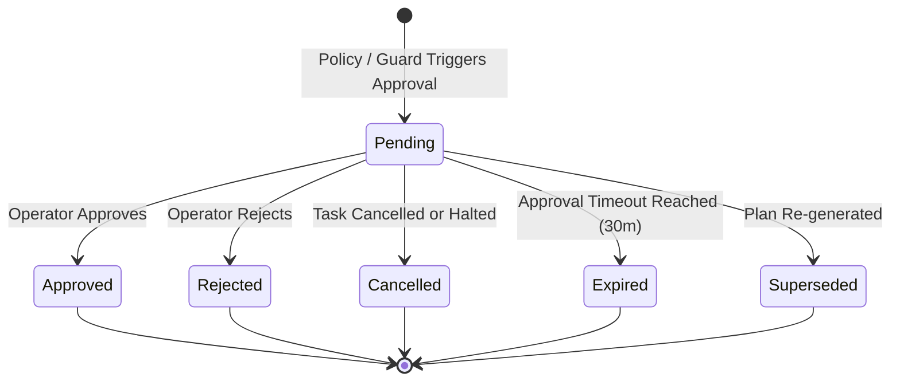
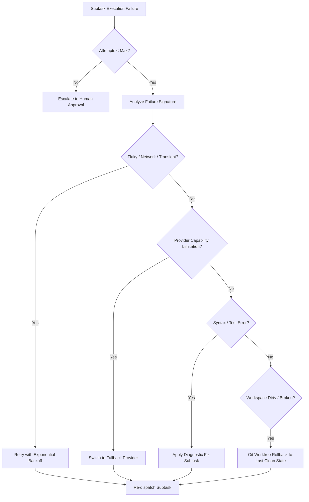

# AUTONOMOUS OPERATIONS ARCHITECTURE (PHASE 4)
**Document ID:** AOA-SPEC-001  
**Version:** 1.0.0  
**Status:** APPROVED FOR IMPLEMENTATION  
**Date:** 2026-11-12  
**Target Repository:** `my-office` (`d:\somehting code\my-office`)

---

## 1. Executive Summary & Architectural Vision

The **Autonomous Operations Platform** (Phase 4) elevates My Office from a guided, step-by-step orchestrator into a multi-tiered autonomous operating system for AI engineering agents. It allows heterogeneous agents (Claude Code, Codex CLI, Codex App, Antigravity) to plan, execute, verify, and self-heal complex multi-stage tasks while strictly guaranteeing that human operators retain ultimate supervisory control, resource bounding, and instantaneous emergency stop capabilities.

The core philosophy is **Progressive Autonomy with Non-Bypassable Invariants**:
- Autonomy can be throttled or elevated across four distinct operational tiers (`readonly`, `assisted`, `supervised`, `autonomous`).
- No agent may elevate its own autonomy level or bypass quality and security gates.
- Strict budget caps prevent runaway loops, infinite retries, and token exhaustion.
- Every state transition is auditable, deterministic, and subject to human intervention.

---

## 2. Core Architectural Principles & Invariants

1. **Non-Bypassable Security Invariants**:
   - An agent is never allowed to grant itself additional permissions.
   - Mandatory Quality Gates (Functional, Static Quality, Security, Coverage) can never be skipped or downgraded silently.
   - Destructive operations, out-of-boundary file system access, and critical security overrides strictly require human authorization.

2. **Truthful Multi-Provider Execution**:
   - Built on top of the Phase 1 Capability Registry: commands and cancellations honor native provider capabilities (e.g. Claude Code CLI and Codex CLI support process termination/cancellation, while Codex App GUI acts as an observed external client).
   - Cancellation requests are strictly tracked and distinguished from confirmed process termination.

3. **Circuit Breakers & Self-Healing Boundaries**:
   - Automated self-healing is bounded by exponential backoff, maximum remediation attempt limits per subtask, and global remediation budgets.
   - Loop detection terminates cyclic failures before exhausting quotas.

4. **Instantaneous Emergency Stop**:
   - A single trigger instantaneously blocks all future dispatches system-wide and sends cancellation signals to all running agent processes.

5. **Decoupled Architecture & Shared Contracts**:
   - All modules (`backend`, `frontend`, `security`, `qa`) communicate against a single immutable schema and state contract defined in `server/autonomous/contracts.mjs`.

---

## 3. Autonomy Levels Spectrum

The platform defines four discrete Autonomy Levels:

| Autonomy Level | Risk Tier | Safe Writes Permitted | Non-Destructive Commands | Self-Healing Remediation | Human Approval Triggers |
| :--- | :---: | :---: | :---: | :---: | :--- |
| **`readonly`** | None | ❌ Blocked | ❌ Read-Only Only | ❌ Manual Only | Any write, file edit, destructive command, or git mutation. |
| **`assisted`** | Low | ⚠️ Approval Required | ⚠️ Approval Required | ⚠️ Approval Required | Every actionable step, command execution, and file change. |
| **`supervised`** *(Default)* | Medium | ✅ Auto-Approved (Bounded) | ✅ Auto-Approved (Whitelisted) | ✅ Auto-Approved (Safe Retries) | Destructive operations, out-of-bounds files, permission changes, git push. |
| **`autonomous`** | High | ✅ Auto-Approved | ✅ Auto-Approved | ✅ Auto-Approved | Critical security overrides, budget increases, emergency halts. |

### 3.1 Detailed Autonomy Level Specifications

#### Level 1: `readonly`
- **Intent:** High-security auditing, codebase exploration, code reviews, and threat modeling.
- **Behavior:** Agents execute read-only tools (`grep`, `cat`, AST search, documentation generation). Any attempt to write to disk, run modifying shell scripts, or delete files is blocked and queued as an approval request.
- **Remediation:** Purely diagnostic; no automated modifications permitted.

#### Level 2: `assisted` (Step-by-Step)
- **Intent:** Pair-programming and careful incremental refactoring.
- **Behavior:** The agent formulates plans, identifies bugs, and proposes exact file diffs or shell commands. The execution halts at each step until the human operator clicks **Approve**, **Reject**, or submits an **Intervention** edit.
- **Remediation:** Suggestions are proposed to the user, but never auto-applied.

#### Level 3: `supervised` (Safe Auto - Default)
- **Intent:** Standard autonomous development workflow within a repository.
- **Behavior:** Agents execute bounded workspace edits, run build tools, run linter and unit tests, and resolve compilation errors autonomously.
- **Guardrails:** Destructive operations (e.g. `rm -rf`, modifying root/outside files), network pushes, credential access, or security gate bypasses immediately halt execution and trigger human approval requests.

#### Level 4: `autonomous` (Self-Driving)
- **Intent:** End-to-end task execution, long-running batch migrations, automated bug hunting, and full remediation loops.
- **Behavior:** The scheduler autonomously decomposes tasks, executes subtasks, evaluates QA quality gates, invokes diagnostic fixes, and switches providers if an agent fails.
- **Guardrails:** Bounded strictly by execution budgets (max cost, max subtasks, max time), security invariants, and emergency stop.

---

## 4. State Machines & Operational Lifecycles

### 4.1 Autonomy Execution State Machine



### 4.2 Emergency Stop State Machine



### 4.3 Human Approval State Machine



---

## 5. Data Structures & Schemas

The contract module `server/autonomous/contracts.mjs` defines and validates the following core data models.

### 5.1 Autonomous Policy Schema
```typescript
interface AutonomousPolicy {
  autonomyLevel: 'readonly' | 'assisted' | 'supervised' | 'autonomous';
  allowAutoRemediation: boolean;
  requireHumanApprovalForCritical: boolean;
  strictQualityGates: boolean;
  enforceFileBoundaries: boolean;
  budget: BudgetLimits;
  selfHealing: SelfHealingPolicy;
  allowedActionTypes: string[];
}
```

### 5.2 Budget Limits & Usage Tracking Schema
```typescript
interface BudgetLimits {
  maxSubtasks: number;           // Default: 25
  maxCostUsd: number;            // Default: 10.00 USD
  maxExecutions: number;         // Default: 50
  maxDurationMinutes: number;    // Default: 60 minutes
  maxConcurrentSubtasks: number; // Default: 3
  maxTokens: number;             // Default: 500,000
}

interface BudgetUsage {
  subtasksCompleted: number;
  totalCostUsd: number;
  executionCount: number;
  durationMinutes: number;
  activeConcurrent: number;
  tokensUsed: number;
}
```

### 5.3 Approval Request Schema
```typescript
interface ApprovalRequest {
  approvalId: string;            // e.g. "appr_1700000000_abc12"
  taskId: string;
  subtaskId: string | null;
  actionType: ApprovalActionType;
  title: string;
  description: string;
  payload: {
    command?: string;
    filePath?: string;
    diff?: string;
    provider?: string;
    riskReason?: string;
    [key: string]: any;
  };
  autonomyLevel: AutonomyLevel;
  riskTier: 'none' | 'low' | 'medium' | 'high' | 'critical';
  requestedBy: string;           // 'system' | agentId
  status: 'pending' | 'approved' | 'rejected' | 'expired' | 'cancelled' | 'superseded';
  createdAt: number;
  expiresAt: number;
  resolvedAt: number | null;
  resolvedBy: string | null;     // 'operator'
  resolutionReason: string | null;
}
```

### 5.4 Self-Healing Policy & Remediation Record
```typescript
interface SelfHealingPolicy {
  defaultMaxRemediationAttemptsPerSubtask: number; // 3
  defaultMaxTotalRemediationsPerTask: number;      // 8
  defaultBackoffBaseMs: number;                   // 1000
  defaultBackoffMultiplier: number;               // 2
  defaultMaxBackoffMs: number;                    // 15000
  allowProviderFallback: boolean;                 // true
  allowGitRollback: boolean;                      // true
  allowedStrategies: SelfHealingStrategy[];
}

interface RemediationRecord {
  remediationId: string;
  subtaskId: string;
  attemptNumber: number;
  strategy: 'retry_with_backoff' | 'switch_provider' | 'git_worktree_rollback' | 'diagnostic_fix' | 'escalate_to_human';
  errorEncountered: string;
  actionTaken: string;
  success: boolean;
  timestamp: number;
}
```

### 5.5 Emergency Stop State Schema
```typescript
interface EmergencyStopState {
  state: 'idle' | 'tripping' | 'cancelling' | 'halted' | 'recovering';
  trippedAt: number | null;
  trippedBy: string | null;     // 'operator' | 'security_guard'
  reason: string | null;
  cancellationsPending: number;
  cancellationsConfirmed: number;
}
```

---

## 6. Human Intervention Points & Escalation Triggers

Execution is paused and routed to human intervention upon encountering any of the following 10 standard triggers:

1. **`budget_exhausted`**: Cost, token, execution, or time limit surpassed.
2. **`execution_loop_detected`**: Repetitive cycle of identical failures or oscillations detected.
3. **`concurrency_limit_reached`**: Active subtask execution count reaches max threshold.
4. **`security_policy_violation`**: Attempt to access sensitive paths (e.g. `.env`, SSH keys) or execute blacklisted commands.
5. **`mandatory_quality_gate_failed`**: Phase 3 Quality Gate fails and requires manual risk acceptance or fix direction.
6. **`out_of_bounds_file_access`**: Agent attempts to touch files outside the designated workspace root.
7. **`destructive_action_detected`**: File deletion, database drops, or hard git resets without approval.
8. **`emergency_stop_triggered`**: Human or watchdog trips the emergency stop.
9. **`max_remediation_exceeded`**: Automated self-healing attempts exceed configured limit (e.g. 3 attempts).
10. **`assisted_step_approval_required`**: In `assisted` mode, all active steps require pre-execution clearance.

---

## 7. Self-Healing & Failure Recovery Architecture



### Infinite Loop Prevention
To guarantee that self-healing cannot enter an infinite loop:
1. Each remediation logs a normalized hash of `errorSignature` + `subtaskId`.
2. If the same error signature recurs 3 times consecutively on the same subtask, self-healing is aborted immediately.
3. The global task remediation budget (default: 8 across all subtasks) acts as a hard stop.

---

## 8. Emergency Stop Mechanics

The Emergency Stop system is designed for **deterministic failure resistance**:

1. **Phase 1: Trip & Block (Atomic)**
   - When triggered, `emergencyStop.state` transitions to `TRIPPING`.
   - The Policy Engine immediately rejects all future dispatches with an `EMERGENCY_STOP_ACTIVE` error.
   - The system transitions to `CANCELLING`.

2. **Phase 2: Signal & Track**
   - Active subtasks across all running providers (Claude Code CLI, Codex CLI, etc.) are issued termination signals.
   - For CLI-based agents, `SIGINT` / `SIGTERM` / process kill signals are sent.
   - `cancellationsPending` is incremented for each dispatched process.
   - As each process exits or unregisters, `cancellationsConfirmed` is incremented.

3. **Phase 3: Halted Confirmation**
   - When all pending processes have terminated, `emergencyStop.state` transitions to `HALTED`.
   - The UI displays a persistent halted banner with full audit diagnostics.

4. **Phase 4: Operator Reset**
   - Only a deliberate operator action via `/api/autonomous/emergency-stop/reset` can move the state to `RECOVERING` and back to `IDLE`.

---

## 9. Integration with Prior Phases & Cross-Module Contract Review

```mermaid
graph TD
    UI[Autonomous Drawer & Console] --> API[/api/autonomous/*]
    API --> PolicyEngine[Autonomous Policy Engine]
    API --> SecurityGuard[Security Guard & Emergency Stop]
    
    PolicyEngine --> Scheduler[Autonomous Scheduler]
    Scheduler --> MasterOrchestrator[Phase 2 Master Orchestrator]
    Scheduler --> QualityGate[Phase 3 Quality Gate Engine]
    Scheduler --> ControlManager[Phase 1 Control Manager]

    ControlManager --> CapabilityRegistry[Phase 1 Capability Registry]
    ControlManager --> Adapters[Claude Code / Codex / Antigravity Adapters]

    QualityGate --> EvidenceCollector[Phase 3 Evidence Collector]
```

### 9.1 Phase 1 (Agent Control Center & Capability Registry) Compatibility
- **Module:** `server/control/capability-registry.mjs` & `server/control/control-manager.mjs`
- **Interface Contract:**
  - `capabilityRegistry.isOperationAllowed(agentId, operation)`
    - Used during autonomous provider selection & fallback: verifies that an agent supports `'start'`, `'cancel'`, and `'steer'`.
  - `controlManager.dispatchTask({ agentId, workingDirectory, instruction, sessionId, expectedArtifacts })`
    - Returns `{ execution, session, providerResult }`. Dispatched executions produce standard `executionId` tracked by budget metrics.
  - `controlManager.cancelExecution(executionId, reason)`
    - Invoked during Emergency Stop or Task Cancellation. Returns `{ ok, executionId, cancelled, status }`.
  - **Status Mapping:** `EXECUTION_STATUSES` (`queued`, `running`, `waiting`, `succeeded`, `failed`, `cancelled`) map 1:1 into Phase 4 execution accounting.

### 9.2 Phase 2 (Master Task Orchestration Engine) Compatibility
- **Module:** `server/orchestration/engine/master-orchestrator.mjs` & `dependency-graph.mjs`
- **Interface Contract:**
  - `masterOrchestrator.createMasterTask({ title, goal, strategy, subtasks })`
  - `masterOrchestrator.dispatchSubtask(masterTaskId, subtaskId)`
  - `SUBTASK_STATUSES`: `queued`, `ready`, `waiting`, `dispatching`, `running`, `succeeded`, `failed`, `cancelled`, `blocked`.
  - **Autonomous Extension:** The `AutonomousScheduler` wraps `masterOrchestrator`. When a subtask transitions to `failed`, the scheduler catches the terminal hook, inspects `remediationHistory`, checks `SELF_HEALING_POLICIES.defaultMaxRemediationAttemptsPerSubtask`, and dynamically injects a remediation subtask or re-dispatches with exponential backoff before marking the Master Task failed.

### 9.3 Phase 3 (Independent QA & Quality Gate Engine) Compatibility
- **Module:** `server/orchestration/qa/quality-gate-engine.mjs` & `review-engine.mjs`
- **Interface Contract:**
  - `qualityGateEngine.evaluateGates({ masterTask, evidenceList, findings, policyOverride })`
  - Returns `{ passed: boolean, gates: Record<string, GateResult>, blockers: string[] }`.
  - Mandatory Gates: `functional`, `staticQuality`, `security`, `requirementCoverage`.
  - **Autonomy Level Invariant:** Under `autonomous` mode, `masterOrchestrator.markMasterTaskSucceeded()` is gated by `qualityGateEngine.evaluateGates()`. If any mandatory gate has status `'failed'`, the autonomous scheduler prevents transition to `COMPLETED`, transitions to `SELF_HEALING` or `AWAITING_APPROVAL`, and notifies the operator. Auto-accepting security risks is strictly forbidden.

---

## 10. REST API Specification (`server/autonomous/autonomous-api.mjs`)

| Method | Endpoint | Description |
| :--- | :--- | :--- |
| `GET` | `/api/autonomous/status` | Current autonomy level, execution state, active budget, stop state |
| `POST` | `/api/autonomous/set-level` | Updates autonomy level (`readonly`, `assisted`, `supervised`, `autonomous`) |
| `GET` | `/api/autonomous/approvals` | Lists pending and historical approval requests |
| `POST` | `/api/autonomous/approvals/:id/resolve` | Resolves an approval request (`action: 'approve' \| 'reject'`, optional note) |
| `POST` | `/api/autonomous/emergency-stop` | Triggers immediate system-wide emergency stop |
| `POST` | `/api/autonomous/emergency-stop/reset` | Resets emergency stop after operator review |
| `GET` | `/api/autonomous/budget` | Retrieves current budget limits, real-time usage, and remaining allowances |
| `POST` | `/api/autonomous/budget/update` | Updates budget limits (operator authorization required) |

---

## 11. Security Guard & Non-Bypassable Invariants

The `server/autonomous/security-guard.mjs` component operates as a standalone security interceptor:
- **Zero Self-Escalation**: It rejects any agent payload requesting `permission_grant` or level changes.
- **Strict Path Filtering**: Rejects any subtask targeting forbidden paths (`.git/hooks`, `.env*`, system directories).
- **Quality Gate Protection**: Rejects any request to complete a task if mandatory Phase 3 Quality Gates have status `'failed'`.
- **Audit Logging**: Every security evaluation, whether approved, rejected, or blocked, is logged immutably with timestamp and context.

---

## 12. Verification & Testing Strategy

To ensure zero regressions across earlier phases:
1. **Unit Tests (`tests/unit/autonomous-policy.test.mjs`)**:
   - Verify all 4 autonomy levels enforce correct approval triggers.
   - Verify budget limits block execution when thresholds are reached.
   - Verify state machine transition guards.
2. **Scheduler Unit Tests (`tests/unit/autonomous-scheduler.test.mjs`)**:
   - Verify self-healing remediation loops, exponential backoff, and loop breaker aborts.
   - Verify concurrency bounds.
3. **Emergency Stop Unit Tests (`tests/unit/autonomous-emergency-stop.test.mjs`)**:
   - Verify instantaneous dispatch blocking.
   - Verify cancellation tracking (requested vs confirmed).
4. **E2E Tests (`tests/e2e/autonomous-operations-live.spec.ts`)**:
   - Playwright UI tests verifying level toggles, approval card rendering, emergency stop triggering, and visual state indicators.
