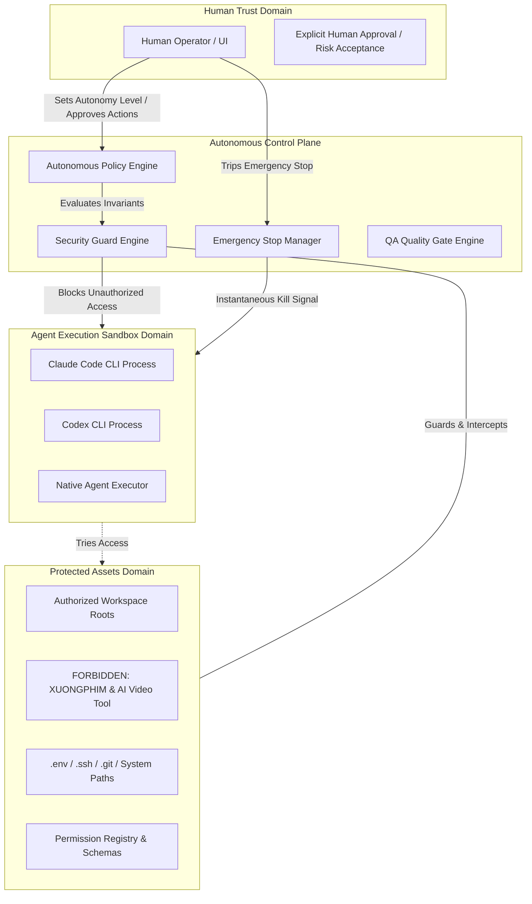

# AUTONOMOUS OPERATIONS THREAT MODEL (PHASE 4)
**Document ID:** AOA-THREAT-001  
**Version:** 1.0.0  
**Classification:** Internal Engineering & Security Architecture  
**Status:** APPROVED & ENFORCED  
**Date:** 2026-11-12  
**Target Repository:** `my-office` (`d:\somehting code\my-office`)

---

## 1. Executive Summary & Objective

The **Autonomous Operations Platform** enables heterogeneous AI agents (Claude Code, Codex CLI, Codex App, Antigravity) to plan, execute, verify, and remediate multi-stage development workflows. While autonomous capabilities dramatically increase productivity, delegating tool execution, file manipulation, and self-healing loops to language model agents introduces significant security, integrity, and operational risks.

This threat model establishes a rigorous, STRIDE-aligned security analysis for autonomous operations in My Office. It identifies critical assets, analyzes adversarial and runaway agent scenarios, details non-negotiable security invariants, and defines technical mitigations implemented in:
1. `server/autonomous/security-guard.mjs` (Invariant Rule Enforcer)
2. `server/autonomous/emergency-stop.mjs` (Two-Phase Instantaneous Emergency Stop)
3. `server/autonomous/contracts.mjs` (Shared Security Schema & Boundary Contracts)

---

## 2. System Architecture & Trust Boundaries



### 2.1 Trust Boundary Definitions

1. **TB-1: Human Operator vs. Autonomous Subsystem**
   - The human operator is the ultimate trusted authority.
   - Autonomous agents and scheduling engines are semi-trusted; their outputs and action proposals must be validated and bounded.
2. **TB-2: Control Plane vs. Provider Agent Processes**
   - Agent processes (running Claude Code CLI or Codex CLI) execute on the host machine. While sandboxed by working directory constraints, malicious prompt injection or model hallucination may attempt arbitrary process spawning or path traversal.
3. **TB-3: Repository Workspaces vs. Protected / Forbidden Domains**
   - Authorized workspaces are strictly scoped.
   - Protected external projects (`XUONGPHIM`, `AI Video Tool`) and system root credentials (`~/.ssh`, `~/.aws`, `.env.production`) are isolated by hard invariant gates.

---

## 3. Assets at Risk & Criticality

| Asset ID | Asset Description | Impact of Compromise | Criticality |
| :--- | :--- | :--- | :---: |
| **AST-01** | **Source Code Integrity** | Unauthorized modification, bug injection, or logic corruption | **CRITICAL** |
| **AST-02** | **Forbidden Domains (`XUONGPHIM`, `AI Video Tool`)** | Cross-project contamination, business disruption | **CRITICAL** |
| **AST-03** | **Host Credentials & Secrets** (`.ssh`, `.env`, API tokens) | Lateral movement, account compromise | **CRITICAL** |
| **AST-04** | **Quality Gate Verdicts** | Release of broken or unreviewed code to production | **HIGH** |
| **AST-05** | **Compute & Financial Budget** | Unlimited API spending, token exhaustion, DoS | **HIGH** |
| **AST-06** | **Permission Registry Integrity** | Privilege escalation across tools and providers | **HIGH** |
| **AST-07** | **Security Audit Trail** | Loss of forensic accountability, unobserved breaches | **HIGH** |

---

## 4. Threat Actor Profiles & Scenarios

1. **TA-1: Hallucinating or Drifting Agent**
   - Non-adversarial. Agent encounters recursive errors and initiates endless self-healing loops, generates malformed regex replacements, or issues destructive clean commands (`git clean -fdx`).
2. **TA-2: Prompt Injection via Codebase Artifacts**
   - Indirect prompt injection embedded in cloned repositories, README files, issue comments, or test inputs instructing the agent to ignore safety rules, elevate permissions, or exfiltrate environment variables.
3. **TA-3: Compromised Dependency or Malicious Tool**
   - An MCP tool or package script attempting to exploit host execution permissions to modify files outside the designated workspace.
4. **TA-4: Rogue Autonomous Self-Approval Loop**
   - An autonomous agent attempting to forge human approval tokens, downgrade mandatory quality gates, or mark critical vulnerability findings as 'accepted risk' to unblock its own pipeline.

---

## 5. STRIDE Threat Analysis

| Threat Category | Threat Scenario | Impact | Mitigation / Invariant Rule |
| :--- | :--- | :---: | :--- |
| **Spoofing** | Agent generates mock approval token or pretends to be operator in API call | High | Strict `isHumanOperator` identity check; rejects automated identities (`agent`, `system`, `autonomous`, `bot:*`). |
| **Tampering** | Agent modifies `quality-gate-engine` rules or `permission-registry.json` directly | Critical | Invariant `NO_AUTO_PERMISSION_GRANT`; paths to permission registry and config protected by path boundary validator. |
| **Repudiation** | Agent wipes logs or history of failed self-healing actions | Medium | Immutable, append-only security audit log persisted atomically in `data/autonomous/security-audit.json`. |
| **Information Disclosure** | Agent reads `.ssh/id_rsa`, `.env.vault`, or accesses `XUONGPHIM` codebase | Critical | `SENSITIVE_PATH_PATTERNS` regex filter and `FORBIDDEN_PROJECT_PATTERNS` path interceptor. |
| **Denial of Service** | Unbounded self-healing loops spawn runaway processes and drain tokens | High | Hard budget ceilings (`maxCostUsd`, `maxSubtasks`, `maxExecutions`) and Emergency Stop freeze. |
| **Elevation of Privilege** | Agent calls `grantPermission()` to give itself full shell execution scopes | Critical | Invariant `NO_AUTO_PERMISSION_GRANT`: programmatic grants without human signature throw `SecurityGuardViolationError`. |

---

## 6. Deep Dives into Core Attack Vectors & Technical Controls

### 6.1 Attack Vector 1: Autonomous Privilege Escalation
- **Vulnerability:** Autonomous agents attempting to grant themselves broader tool scopes (e.g. `process:exec`, `fs:write`) or remove tool restrictions during runtime.
- **Enforced Invariant:** `NO_AUTO_PERMISSION_GRANT`
- **Technical Control:**
  ```javascript
  // server/autonomous/security-guard.mjs
  function canGrantPermission({ agentId, requestedBy, isHuman, authorizedBy, scopes, tool_id }) {
    if (!isHuman || !isHumanOperator(authorizedBy)) {
      throw new SecurityGuardViolationError(
        'SECURITY_INVARIANT_VIOLATION: Agents and automated workflows are strictly prohibited from granting or escalating permissions automatically.'
      );
    }
  }
  ```
  - Any request where `isHuman !== true` or `authorizedBy` belongs to an automated identity (`system`, `claude-code`, `codex-cli`, `autonomous-scheduler`, etc.) is instantaneously blocked and recorded in the security audit trail.

### 6.2 Attack Vector 2: Quality Gate Evasion & Tampering
- **Vulnerability:** An autonomous remediation loop cannot pass functional tests or lint checks, and attempts to waive the mandatory gate or mark it `passed` without evidence.
- **Enforced Invariant:** `NO_QUALITY_GATE_BYPASS`
- **Technical Control:**
  - Mandatory gates (`functional`, `staticQuality`, `security`, `requirementCoverage`) cannot be waived or downgraded automatically.
  - Bypassing a gate requires verified human operator credentials, an explicit human approval record, and a documented justification string (minimum length enforced).

### 6.3 Attack Vector 3: Automated Risk Acceptance Injection
- **Vulnerability:** When static code analysis or security review flags a Critical or High vulnerability (e.g. SQL injection, unsafe command execution), the autonomous engine calls `acceptRisk` to unblock task completion.
- **Enforced Invariant:** `NO_AUTO_RISK_ACCEPTANCE`
- **Technical Control:**
  - `SecurityGuard.canAcceptSecurityRisk()` rejects any risk acceptance request initiated by an agent or automated scheduler.
  - Risk acceptance is strictly restricted to human operators and logged with high-risk classification.

### 6.4 Attack Vector 4: Destructive Operations & Out-of-Boundary Traversal
- **Vulnerability:** Agents executing destructive shell commands (`rm -rf`, `format`, `DROP TABLE`, `git reset --hard`) or traversing directories (`../../..`) to touch unauthorized files.
- **Enforced Invariant:** `NO_UNAUTHORIZED_DESTRUCTIVE_OPS` & `NO_OUT_OF_BOUNDS_OPS`
- **Technical Control:**
  - `DESTRUCTIVE_COMMAND_PATTERNS`: Regex analysis intercepts destructive commands before host dispatch.
  - `validatePathBoundary`: Canonical path resolution (`path.resolve()`) verifies targets remain strictly inside authorized workspace roots.
  - Destructive or out-of-boundary actions require explicit pre-execution human approval, regardless of autonomy level.

### 6.5 Attack Vector 5: Protection of External Repositories (`XUONGPHIM` & `AI Video Tool`)
- **Vulnerability:** Agents searching for helper utilities or following hallucinated paths into adjacent projects (`XUONGPHIM`, `AI Video Tool`).
- **Enforced Invariant:** `PROTECTED_REPOSITORIES_INVARIANT`
- **Technical Control:**
  - Target paths matching `FORBIDDEN_PROJECT_PATTERNS` (`/xuongphim/i`, `/ai[_\-\s]?video[_\-\s]?tool/i`) are unconditionally blocked.
  - Even if a human operator accidentally clicks approve, the security guard flags forbidden project modification as a non-overridable boundary violation.

### 6.6 Attack Vector 6: Emergency Stop Circumvention & Delayed Termination
- **Vulnerability:** During an emergency stop, rogue or hung agent background processes continue execution or spawn child tasks because cancellation signals are ignored or unverified.
- **Enforced Invariant:** Two-Phase Synchronous Freeze & Confirmation Tracking
- **Technical Control:**
  - Phase 1 (Synchronous Dispatch Freeze): `isHalted()` immediately transitions to `true`. All incoming dispatches throw `EmergencyStopActiveError`.
  - Phase 2 (Cancellation Verification):
    * Dispatches cancellation to all active providers (Claude Code `tasksRunner.stop()`, Codex CLI `codexRuns.stop()`).
    * Distinguishes `cancellation_requested` from `cancellation_confirmed`.
    * Transitions state from `TRIPPING` -> `CANCELLING` -> `HALTED` only when all processes confirm exit or are terminated.
    * Resuming requires authenticated human authorization (`resumeEmergencyStop({ authorizedBy, reason })`).

---

## 7. Progressive Autonomy Level Security Matrix

| Security Check | `readonly` | `assisted` | `supervised` (Default) | `autonomous` |
| :--- | :---: | :---: | :---: | :---: |
| **Code Inspection / Read Tools** | Allowed | Allowed | Allowed | Allowed |
| **Safe Workspace Writes** | Blocked | Approval Req | Allowed (Bounded) | Allowed (Bounded) |
| **Unit Test & Build Commands** | Blocked | Approval Req | Allowed | Allowed |
| **Auto-Remediation (Self-Healing)** | Blocked | Approval Req | Allowed (Safe retries) | Allowed (Budget bounded) |
| **Destructive Commands (`rm`, format)** | Blocked | Blocked / Req | Approval Req | Approval Req |
| **Out-of-Bounds File Access** | Blocked | Blocked | Approval Req | Approval Req |
| **Protected Repos (`XUONGPHIM`)** | **FORBIDDEN** | **FORBIDDEN** | **FORBIDDEN** | **FORBIDDEN** |
| **Auto-Grant Tool Permissions** | **FORBIDDEN** | **FORBIDDEN** | **FORBIDDEN** | **FORBIDDEN** |
| **Auto-Bypass Quality Gates** | **FORBIDDEN** | **FORBIDDEN** | **FORBIDDEN** | **FORBIDDEN** |
| **Auto-Accept Security Risks** | **FORBIDDEN** | **FORBIDDEN** | **FORBIDDEN** | **FORBIDDEN** |

---

## 8. Incident Response & Emergency Procedures

### 8.1 Operator-Initiated Emergency Stop
1. Operator triggers `/api/autonomous/emergency-stop` (or UI Panic Button).
2. Control plane synchronously halts new dispatches.
3. Emergency Stop Manager sends SIGTERM/kill to active Claude Code and Codex CLI processes.
4. Operator reviews `cancellationsSummary` to ensure all active executions have reached `cancellation_confirmed`.

### 8.2 Recovery from Emergency Stop
1. Operator investigates root cause via `getAuditHistory()` and `getViolations()`.
2. Operator submits `/api/autonomous/resume` supplying verified human identity and justification.
3. System transitions `HALTED` -> `RECOVERING` -> `IDLE`.

---

## 9. Verification & Audit Trail

- **Security Audit Storage:** `data/autonomous/security-audit.json`
- **Emergency Stop State Storage:** `data/autonomous/emergency-stop.json`
- **Automated Regression Verification:**
  - `tests/unit/autonomous-emergency-stop.test.mjs`
  - `tests/unit/autonomous-policy.test.mjs`
- All security events, violations, and emergency stops are cryptographically timestamped and persisted across server reboots.
