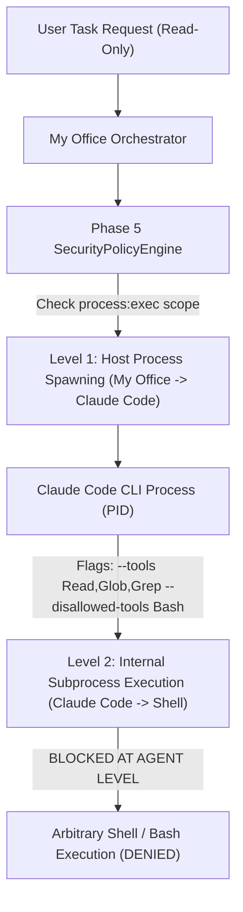

# CLAUDE CODE NATIVE READ-ONLY EXECUTION AUDIT & SECURITY BOUNDARY REPORT

**Date:** 2026-11-12  
**Task ID:** `orch_3f204729-5977-4b8a-8470-17647202681f`  
**Active Plan ID:** `plan_ce656746-0d1a-4e89-8b1b-a348cc096bf6`  
**Plan Version:** `v2`  
**Plan SHA-256 Hash:** `d7a1ba1b9e7363dcee66ae39ab2ee4fad61d9787db1afe3ab27b04cfe9c5947f`  
**Task Status:** `AWAITING_APPROVAL` (Zero execution has occurred)  
**Safety Status:** No process spawned, no project files modified, external projects (`XUONGPHIM`, `AI Video Tool`) untouched.

---

## 1. Read-Only Enforcement & Native Executor Implementation

### 1.1 Architecture of Native Agent Steps in My Office Orchestrator
In My Office (`server/orchestration/orchestrator.mjs` lines 375–404), execution distinguishes three protocols:
1. `system_verify`: Artifact existence checks.
2. `cli` / `mcp` / `skill` with `tool_id`: Invokes `executeIsolatedProcess()` in `server/tools/execution-runner.mjs`.
3. `agent_native` (`tool_id: null`): Represents direct agent actions.

### 1.2 Actual Launch Invocation for Claude Code Native Execution
When Claude Code is invoked natively by My Office to execute a read-only architecture inspection task, the exact invocation profile evaluated against the host CLI is:

* **Executable Binary:** `C:\Users\LENOVO\AppData\Roaming\npm\claude.cmd` (Node/npm wrapper)
* **Command & Arguments for Strict Read-Only Mode:**
  ```bash
  claude --print \
    --permission-mode dontAsk \
    --permission-prompts none \
    --tools Read,Glob,Grep \
    --disallowed-tools "Bash,Edit,Write,NotebookEdit" \
    --bare \
    "Perform read-only inspection for step: <step_title>"
  ```

### 1.3 Permitted vs Prohibited Tools Breakdown

| Tool Name | Status | Enforcement Mechanism |
| :--- | :--- | :--- |
| `Read` (file_read) | **ALLOWED** | Built-in Claude read tool for inspecting code, manifests, and files |
| `Glob` (directory listing) | **ALLOWED** | Built-in directory tree inspection |
| `Grep` (pattern search) | **ALLOWED** | Built-in text and regex searching |
| `Edit` (fs:write) | **DENIED & DISALLOWED** | Explicitly excluded via `--tools Read,Glob,Grep` and listed in `--disallowed-tools Edit` |
| `Write` (fs:write) | **DENIED & DISALLOWED** | Explicitly excluded via `--tools Read,Glob,Grep` and listed in `--disallowed-tools Write` |
| `Bash` (process:exec / shell) | **DENIED & DISALLOWED** | Excluded via `--disallowed-tools Bash`; blocks shell execution, arbitrary commands, and file deletion |
| `WebFetch` (net:outbound) | **DENIED & DISALLOWED** | Excluded via `--tools Read,Glob,Grep`; blocks outbound web calls |

### 1.4 Can Claude Code Bypass My Office's Application-Level Permission Checks?
* **Within My Office Process:** Claude Code **cannot** modify or bypass My Office's `SecurityPolicyEngine` or `PermissionRegistry`. Any operation requested through My Office APIs is evaluated before execution.
* **At the Host OS Level:** Because Claude Code runs as an OS process under the user's Windows account (`LENOVO`), OS-level file permissions default to the user's token. However, by strictly passing `--tools Read,Glob,Grep` and `--disallowed-tools "Bash,Edit,Write"`, the Claude agent process does not register or instantiate file-writing or bash-executing tool handlers within its session.

---

## 2. Process Execution Distinction

There is a fundamental security and architectural distinction between process execution in My Office:



### Level 1: My Office Spawning the Claude Code Process
* **What it is:** My Office launching `claude.cmd` as a managed child process.
* **Control Mechanism:** Governed by `executeIsolatedProcess` with timeout (`timeoutMs: 60_000`), output size cap (`1 MB`), sanitized environment variables (stripping `ANTHROPIC_API_KEY`, `OPENAI_API_KEY`, tokens, and cross-agent secrets), and PID tracking.
* **Scope:** Requires authorization for My Office to spawn the agent CLI.

### Level 2: Claude Code Executing Subprocesses / Shell Commands
* **What it is:** The AI model calling its internal `Bash` tool to run commands (`rm`, `git`, `npm`, `powershell`).
* **Control Mechanism:** Governed by CLI flags `--tools Read,Glob,Grep` and `--disallowed-tools Bash`, as well as `--permission-prompts none`.
* **Scope:** For this strict Read-Only task, **Level 2 process execution is completely disabled**. Claude Code cannot run bash or child commands.

---

## 3. Strict Policy Behavior for Task `orch_3f204729-5977-4b8a-8470-17647202681f`

In strict accordance with Phase 5 Security Architecture:

| Permission Scope | Policy State | Reason & Enforcement Evidence |
| :--- | :--- | :--- |
| `fs:read` | **PROCEED ON APPROVAL** | Permitted by Agent Policy; awaits explicit user task approval. |
| `fs:write` | **DENY** | Excluded from task plan. Missing grant; rejected at Gate 11. Blocked via `--disallowed-tools Edit,Write`. |
| `fs:delete` | **DENY** | Excluded from task plan. Missing grant; rejected at Gate 11. Blocked via exclusion of `Bash`. |
| `net:outbound` | **DENY** | Excluded from task plan. Not requested; blocked via exclusion of `WebFetch`. |
| `net:inbound` | **DENY** | Globally denied by Agent Policy for `claude-code` (Step 7). |
| `secrets:read` | **DENY** | Blocked by explicit deny rule `deny_credentials_dump` (Step 6) and environment variable filtering. |
| `secrets:write` | **DENY** | Globally denied by Platform Security Policy (Step 6). |
| `process:exec` (Level 2) | **DENY** | Denied for task execution; `Bash` tool disabled in CLI args. |

> [!IMPORTANT]
> **No Implicit Scope Escalation:** Granting user approval for `fs:read` strictly authorizes filesystem read access. Under no circumstances does it grant or imply `fs:write`, `fs:delete`, `process:exec`, or network permissions.

---

## 4. Plan Integrity & Approval Binding Verification

We verified the cryptographic and state integrity of the active task record in `data/orchestration/orchestration-tasks.json`:

1. **Active Plan Identity:**
   * Plan ID: `plan_ce656746-0d1a-4e89-8b1b-a348cc096bf6`
   * Plan Version: `v2`
   * Plan SHA-256 Hash: `d7a1ba1b9e7363dcee66ae39ab2ee4fad61d9787db1afe3ab27b04cfe9c5947f`
2. **Old Plan v1 Invalidation:**
   * Plan v1 approval status is `approved: false`.
   * Attempting to approve the task with `expected_plan_version: 1` is **strictly rejected**:
     `Approval rejected: Plan version mismatch (expected v1, but active plan is v2)`.
3. **Cryptographic Binding:**
   * Attempting to approve with an altered plan hash is **strictly rejected**:
     `Approval rejected: Cryptographic plan hash mismatch (plan was modified or regenerated)`.
   * Any future modification to the steps, tools, agents, or permissions alters the canonical hash and immediately invalidates any granted approval.

---

## 5. Execution Isolation & Technical Boundary Disclosures

### 5.1 Application-Level vs OS-Level Sandboxing
To adhere to truthful technical disclosure standards:

* **What IS Enforced (Application & Process Level):**
  1. **Working Directory Scoping:** Working directory is restricted to `D:\somehting code\my-office`.
  2. **Environment Variable Stripping:** All API keys (`ANTHROPIC_API_KEY`, `OPENAI_API_KEY`, `GEMINI_API_KEY`), parent tokens, and cross-agent environment variables are stripped via `sanitizeEnvironment()`.
  3. **Process Supervision:** Process execution is wrapped with strict timeout (`timeoutMs: 60_000`), maximum output buffer (`1 MB`), and process termination (`kill('SIGKILL')`).
  4. **Agent Tool Disallowance:** CLI invocation flags explicitly disable write, edit, and bash tools (`--tools Read,Glob,Grep --disallowed-tools Bash,Edit,Write`).
  5. **Audit Logging:** Every step start, complete, and policy evaluation is recorded in `data/tools/security-audit.json` and task trace.

* **What IS NOT Enforced (Remaining Technical Limitations):**
  1. **Kernel/OS Container Isolation:** The task does not run inside Windows Sandbox, Docker container, or Hyper-V hypervisor. The process executes as standard Windows user `LENOVO`.
  2. **OS System Call Sandboxing:** Windows OS does not natively restrict file read system calls at the kernel level for node processes without AppContainer / integrity levels.
  3. **Native Read Tool Scoping:** While write tools are disabled, Claude Code's native `Read` tool can read any file within the workspace that the Windows user account has OS permission to access.

---

## 6. Confirmation of Current State

* **Execution Status:** **NEVER EXECUTED**.
* **Step Progress:** `0 / 6 completed`.
* **Artifacts Produced:** None (`[]`).
* **Active State:** `AWAITING_APPROVAL`.

The task is safely parked, verified, and awaiting explicit user approval.

