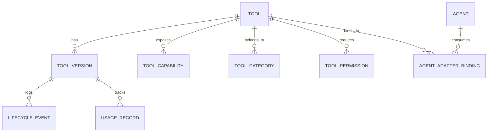
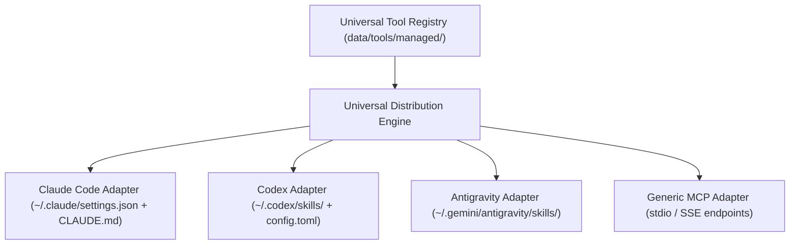

# UNIVERSAL AI TOOL ECOSYSTEM — IMPLEMENTATION PLAN
**Document ID:** UTE-PLN-001  
**Version:** 1.0.0  
**Status:** READY FOR REVIEW & USER APPROVAL (Phase 0 Deliverable)  
**Date:** 2026-11-12  
**Target Repository:** `my-office` (`d:\somehting code\my-office`)

---

## 1. Architectural Strategy & Design Principles

The Universal AI Tool Ecosystem transforms My Office into a unified management and orchestration hub for heterogeneous AI tools, skills, and agents.

### Core Design Principles
1. **Tool Independence**: Tools exist as first-class entities with independent lifecycles, versions, health checks, and permissions—independent of which agents happen to consume them.
2. **Universal Multi-Protocol Architecture**: Support MCP (stdio, SSE, HTTP), CLI tools, Agent Skills (`SKILL.md`), REST APIs, and lifecycle hooks under a single polymorphic abstraction.
3. **Single Install, Multi-Agent Distribution**: Tools install once into a shared managed location (`data/tools/managed/`). Agent-specific adapters project or wire those capabilities into Claude Code, Codex, Antigravity, and future agents without duplicate disk footprints.
4. **Zero Overwrite Safety**: Agent configurations (e.g. `~/.claude/settings.json`, `~/.codex/config.toml`, Antigravity configs) are backed up before any write, merged non-destructively, and restored cleanly upon tool uninstallation.
5. **Static-First Discovery**: Untrusted repositories are statically analyzed for capabilities, dependencies, licenses, and security risks. Installation requires explicit user approval.
6. **Dynamic Capability Matching**: The orchestration engine inspects task requirements, matches required capabilities, and injects the minimal necessary toolset rather than dumping all tools into context.

---

## 2. Universal Schema & Database Architecture

To maintain zero native compilation issues on Windows while providing high-integrity querying, migrations, and concurrency safety, the persistence layer uses a versioned, atomic-file JSON relational registry (`data/tools/registry.json`), backed by in-memory indexing, transaction locks, and schema validation.

### 2.1 Entity Model



### 2.2 Tool Registry Schema (`data/tools/registry.json`)

```typescript
export interface UniversalTool {
  tool_id: string;                      // Normalized slug (e.g., 'ponytail-qa', 'context7', 'graphify')
  name: string;                         // Display name
  description: string;                  // Full description
  source_repository: string;            // GitHub URL or local path
  repository_owner: string;             // GitHub user/org or 'local'
  version: string;                      // Current installed version
  latest_available_version: string;     // Latest discovered upstream version
  pinned_version: string | null;        // Pinned version if user locks it
  license: string;                      // SPDX license identifier (MIT, Apache-2.0, etc.)
  installation_type: 'git' | 'npm' | 'python' | 'binary' | 'skill_folder' | 'system';
  categories: string[];                 // Extensible category list
  capabilities: ToolCapability[];       // Fine-grained capabilities exposed
  integration_protocols: ('mcp' | 'cli' | 'skill' | 'api' | 'hook')[];
  supported_agents: string[];           // Agents known to work upstream
  compatible_agents: string[];          // Agents verified in this My Office instance
  required_permissions: ToolPermission[];
  dependencies: {
    system: string[];                   // e.g. ['python>=3.10', 'git']
    tools: string[];                    // other tool_ids
    packages: string[];                 // pip/npm packages
  };
  configuration_schema: Record<string, any>; // JSON Schema for tool configuration
  installation_path: string;            // Path under data/tools/managed/
  health_status: 'healthy' | 'degraded' | 'unhealthy' | 'unknown';
  installation_status: ToolLifecycleState;
  enabled_status: boolean;
  security_status: 'clean' | 'warnings' | 'quarantined' | 'unreviewed';
  conflict_status: {
    has_conflicts: boolean;
    conflicting_tool_ids: string[];
    conflict_reasons: string[];
  };
  verification_evidence: VerificationEvidence[];
  installed_at: string;                 // ISO 8601
  updated_at: string;                   // ISO 8601
  usage_summary: {
    total_invocations: number;
    last_used: string | null;
    success_rate: number;
    average_duration_ms: number;
  };
}

export type ToolLifecycleState =
  | 'discovered'
  | 'under_review'
  | 'pending_approval'
  | 'installing'
  | 'installed'
  | 'configuring'
  | 'verifying'
  | 'healthy'
  | 'disabled'
  | 'update_available'
  | 'updating'
  | 'failed'
  | 'conflict_detected'
  | 'uninstalling'
  | 'uninstalled';

export interface ToolCapability {
  capability_id: string;               // e.g., 'code_intelligence.graph', 'video.qa_inspection'
  name: string;
  protocol: 'mcp' | 'cli' | 'skill' | 'api' | 'hook';
  entry_point: string;                 // executable, skill folder, or MCP command
  input_schema?: Record<string, any>;
  output_schema?: Record<string, any>;
}

export interface ToolPermission {
  scope: 'fs:read' | 'fs:write' | 'net:outbound' | 'process:exec' | 'env:read';
  target: string;                      // Path, domain, or environment variable pattern
  justification: string;
  granted: boolean;
  granted_at: string | null;
}
```

---

## 3. Tool Evaluation & Preserved Implementations

### 3.1 Initial Tool Evaluation Matrix

| Tool | Upstream / Repository | License | Supported Protocols | Supported Agents | Security & Permission Scope | Overlaps | Recommendation |
|---|---|---|---|---|---|---|---|
| **Ponytail** | `d:\somehting code\xuongphim\tools\video_qa.py` (Local / Xuongphim) | Proprietary / Internal MIT | CLI, Python module | Claude Code, Codex, Custom | `fs:read` (video renders), `fs:write` (`data/qa_history/`), `process:exec` (Python/OpenCV/FFmpeg) | None (Specialized video QA) | **Keep & Wrap**: Maintain `server/production/qa.mjs` and register Ponytail as a first-class tool in the Universal Registry under category `Video Generation` & `Testing and QA`. |
| **Graphify** | GitHub / Open Source Code Intelligence | MIT / Apache | CLI, Python, MCP | Claude Code, Codex, Antigravity | `fs:read` (source trees), `fs:write` (graph artifact outputs) | Complements Serena & Context7 | **Integrate**: Add to Registry under `Code Intelligence` & `Context Optimization` to build AST/call graphs for workflow planning. |
| **Agency Agents** | GitHub / Specialist Agent Prompts & Roles | MIT | Agent Skills (`SKILL.md`), System Prompts | Claude Code, Codex, Antigravity | Read-only markdown & role prompts; no arbitrary code execution | Agent framework personas | **Integrate**: Register as `Agent Frameworks` & `Agent Skills` multi-persona library. |
| **Superpowers** | GitHub / Agent Extensible Skills | MIT | Agent Skills, CLI | Claude Code, Codex, Antigravity | Shell execution, filesystem access | Agent Skills ecosystem | **Integrate with Review**: Inspect scripts statically; allow users to pick approved skills. |
| **Serena** | GitHub / Code Intelligence & Editing Agent | Apache-2.0 / MIT | CLI, MCP | Claude Code, Codex | `fs:read`, `fs:write`, AST parsing | Overlaps partially with standard file editing | **Integrate as Specialist**: Coding Workflow Tools category. |
| **Context7** | GitHub / Documentation Retrieval MCP | MIT | MCP (stdio / SSE) | Claude Code, Codex, Antigravity | `net:outbound` (docs API fetch), read-only | Documentation retrieval | **Integrate**: High value for token reduction and accurate documentation search. |
| **context-compress** | GitHub / Token Pruning Utility | MIT / Apache-2.0 | CLI, Python | All Agents | In-memory text processing | Headroom | **Integrate**: Dedicated category `Token Reduction` & `Context Optimization`. |
| **Headroom** | GitHub / Context Window Manager | MIT | CLI, Proxy | All Agents | In-memory token budgeting | context-compress | **Integrate**: Category `Token Reduction`. |
| **Agent Skills Ecosystem** | Open Standards (`SKILL.md`) | Diverse | Agent Skills (`SKILL.md`) | Claude Code, Codex, Antigravity | Declared per skill | N/A | **First-Class Core Support**: Universal distribution of `SKILL.md` folders to all supported agents. |

---

## 4. Universal Distribution Engine & Agent Adapters

A tool installs once into `data/tools/managed/<tool_id>/<version>/`.
Distribution to agents occurs through dedicated, reversible adapters:



### Adapter Safety Invariants
1. **Backup First**: Before altering `~/.claude/settings.json` or `~/.codex/`, create timestamped backup `~/.claude/settings.json.bak.<timestamp>`.
2. **Key Namespace Isolation**: My Office tags its injected configurations (e.g. `mcpServers["my-office-<tool>"]`) so uninstallation deletes exactly those keys, leaving user-created settings 100% untouched.
3. **Symlink / Managed Mirror**: For Agent Skills (`SKILL.md`), prefer NTFS directory junction / symlink on Windows (`mklink /J` or `fs.symlinkSync`), with clean fallback to isolated managed copy if filesystem permissions restrict symlinks.

---

## 5. API Architecture

Extend `server/index.mjs` (modularized in `server/tools/`) with clean REST endpoints:

| Endpoint | Method | Purpose |
|---|---|---|
| `/api/tools` | `GET` | List all registered tools with capabilities, health, and status |
| `/api/tools/discover` | `POST` | Inspect a GitHub URL or local path (static inspection only) |
| `/api/tools/install` | `POST` | Approve and execute installation of a discovered tool |
| `/api/tools/:id/uninstall` | `POST` | Cleanly remove managed tool files and unhook agent adapters |
| `/api/tools/:id/toggle` | `POST` | Enable or disable a tool across all or specific agents |
| `/api/tools/:id/update` | `POST` | Update tool to latest version (with automatic rollback snapshot) |
| `/api/tools/:id/pin` | `POST` | Pin tool to specific version |
| `/api/tools/:id/rollback` | `POST` | Roll back to previous snapshot |
| `/api/tools/:id/health` | `GET` | Execute active health checks (ping MCP, run CLI `--version`) |
| `/api/tools/categories` | `GET`, `POST` | Manage extensible categories |
| `/api/tools/compatibility` | `GET` | Matrix of all tools vs registered agents |
| `/api/tools/permissions` | `POST` | Grant or revoke specific permissions |
| `/api/tools/analytics` | `GET` | Usage statistics, invocation counts, duration |

---

## 6. Frontend Architecture & UI Plan

### 6.1 Placement & Navigation
- Add **AI Tools** button to TopBar (`src/components/office/TopBar.tsx`) with dynamic badge for available updates and health alerts.
- Create `ToolsDrawer` (`src/components/office/ToolsDrawer.tsx`) rendered alongside existing drawers in `app/page.tsx`.
- Tabbed interface matching existing design system:
  1. **Discover**: GitHub URL input, capability badges, security review summary, permission consent checklist, "Install" button.
  2. **Installed Tools**: Search & filter by category, health indicators (green/yellow/red), enabled switches, version info, update buttons.
  3. **Categories**: Category chips (Coding, Context, QA, Video, Audio, MCP, Skills), custom category creator.
  4. **Agent Compatibility**: Grid matrix showing verified compatibility across Claude Code, Codex CLI, Codex App, and Antigravity.
  5. **Permissions & Security**: Audit log of granted capabilities, revocable with one click.
  6. **Usage Analytics**: Real-time invocation charts and task associations.

---

## 7. Phased Implementation Roadmap


### Detailed Phase Milestones

- **Phase 1 — Core Architecture & Schemas**
  - Implement `server/tools/registry.mjs` and `server/tools/schemas.mjs`.
  - Initialize `data/tools/registry.json` and migration system.
  - Register baseline tools: Ponytail QA (`server/production/qa.mjs`), Codex system skills.
  - Unit tests for registry CRUD, schema validation, and concurrency locks.

- **Phase 2 — Discovery Pipeline**
  - Implement `server/tools/discover.mjs`.
  - Static AST and manifest scanner for GitHub repositories (no code execution).
  - Detect capabilities (`mcp.json`, `package.json`, `pyproject.toml`, `SKILL.md`, CLI bins).
  - Security risk detection (scans for hardcoded network calls, obfuscation, dangerous shell commands).

- **Phase 3 — Lifecycle State Machine**
  - Implement `server/tools/lifecycle.mjs` covering all 15 states.
  - Atomic installation to `data/tools/managed/<id>/<version>/`.
  - Version pinning, rollback snapshots in `data/tools/snapshots/`.
  - Automated health check runners (MCP ping, CLI `--version`).

- **Phase 4 — Distribution Engine & Agent Adapters**
  - Implement `server/tools/adapters/`:
    - `claude-adapter.mjs`: Safe merging with `~/.claude/settings.json` and `CLAUDE.md`.
    - `codex-adapter.mjs`: Safe symlink/managed copy to `~/.codex/skills/` and config.
    - `antigravity-adapter.mjs`: Projection into Antigravity skills and sidecars.
    - `generic-mcp-adapter.mjs`: Local stdio/SSE proxying.
  - Rollback and uninstallation cleanup routines.

- **Phase 5 — Security & Permission System**
  - Implement `server/tools/security.mjs` and permission enforcement.
  - Interactive approval workflow before installation.
  - Conflict detection engine (detect duplicate command names or port collisions).

- **Phase 6 — AI Tools UI**
  - Implement `src/components/office/ToolsDrawer.tsx` and `src/office/ui/tools-view.js`.
  - Integrate with TopBar navigation.
  - Build Discover, Installed, Matrix, Permissions, and Analytics panels.

- **Phase 7 — Orchestration & Capability Matching**
  - Extend `server/workflows.mjs` scheduler to support capability requirements per task.
  - Implement capability ranking and dynamic tool injection.
  - Record execution telemetry and usage history in `data/tools/usage.json`.

- **Phase 8 — Final Verification & Acceptance**
  - Run full test suite (`npm test`, `typecheck`, `lint`, and Playwright E2E).
  - Test real GitHub repository discovery and installation flow.
  - Validate non-interference with Ponytail, Claude, Codex, and existing 3D features.
  - Produce final acceptance report with empirical evidence.

